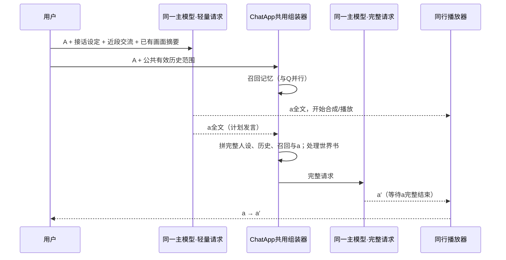

# 同行 demo

从远端 master `5c4aa521` 开始的同行 demo，现整理到独立分支 `codex/companion-api-guide`，包含同行、调试面板及 API 注册配置引导。没有继承此前本地合并和旧代码修改。桌面新增「同行」，入口 `apps/CompanionApp.tsx`。不修改 CallApp、视频演出或通话记录。原设计与对话例子见 [角色陪逛方案](../plans/character-shopping-companion.md)。

## 怎么试

1. 桌面进入「同行」并选择角色。点顶部「API 接入」，查看当前配置、注册平台、获取 Key 并跳到对应设置；已有角色主对话 API 可沿用。
2. 开始前可在右上角编辑「接话设定」：建议写语气、称呼、关系和必须遵守的设定。默认只是人设开头最多 1600 字的摘录，不是模型总结。
3. 直接输入一句话就能验证 a → a′。连续听可在「API 接入 → 听你说话」选择浏览器识别或豆包流式识别 2.0；选择豆包后填写新版语音控制台的 API Key，保存，再点「连续听」。默认仍使用原有浏览器识别，不自动切换服务商。
4. 有角色音色和对应 TTS Key 时沿用原音色；没有则明确使用文字模式。ElevenLabs 使用现有流式 PCM，其他已接入服务商按短段合成播放。
5. 点「开启镜头」立即进入持续实时预览，优先后摄、不镜像，完整画幅等比显示，角色字幕放在画面下方。配置好独立视频 API 后，后台把每段约 8 秒的完整无声 MP4 通过 `video_url` 发送；未配置也可只预览。绿色边框表示模型正在分析已录完的片段，下方同时显示片段结束于多久前、最近已理解画面的年龄。首次没有摘要时角色必须承认尚未看清，不等待视频理解阻塞接话。
6. 主模型是否支持图片由用户判断。「主对话模型支持图片」默认关闭；开启后长回复可附同一视频的 1–3 张截图。也可选择独立识图补充细节，此时主模型仍只收文字。两项互斥，仅本次同行生效，换角色后重新确认；都不开则不提取、不发送截图，也不调用辅助识图。

本地开发：`pnpm dev --host 127.0.0.1 --port 5199`。主应用为 `/`，独立模拟页为 `/test/fixtures/companion.html`。模拟页只验证 UI 和调度，不访问生产存档、不使用真实模型凭据；固定示例回复不代表实际生成质量。

### 实时预览与后台视频理解

画面下方「摄像头来源」可选择浏览器列出的实体或虚拟设备，并通过「刷新设备」重读列表。默认保留自动选择／手机优先后摄；显式选择使用精确 deviceId，不再附加后摄偏好，不因设备占用、消失或报错自动改用别的镜头。帧率仅给 12 fps 偏好，不用 15 fps 硬上限拒绝固定帧率的虚拟源。切换来源先停止旧轮回复、预览和分析、清掉旧观察，再由用户点「开启镜头」；旧权限请求迟到时释放其流，不覆盖新镜头。开启后显示视频轨道报告的实际设备名称。

VTS 需要安装并开启 `Activate Virtual Webcam`，设备通常名为 `VTubeStudioCam`；OBS 则先启动虚拟摄像机。只启动 VTS 不等于已经输出虚拟摄像头。设备列表受浏览器权限限制，缺设备／名称时先允许相机并刷新；首次安装驱动后可能要重启浏览器。`Device in use` 提示检查所选来源、占用和虚拟输出状态，不据此断言服务商 API 出错。设备名称、ID 和当前选择只留本页内存，不进提示词、日志、统计、备份或用户空间设置；Sully-11 设置摘要不推断此临时选择。没有新增埋点或制作格式。

官方参考：[VTube Studio 虚拟摄像头](https://github.com/DenchiSoft/VTubeStudio/wiki/FAQ#what-is-the-virtual-webcam-feature)。组件回归覆盖占用后手选虚拟源、设备消失不回退、切换时旧权限迟到释放；实际 VTS 驱动与 Edge 输出仍需设备实测。

预览 `<video>` 始终绑定当前摄像头的同一条 MediaStream；录制和模型分析不会替换成已录片段，也不等待模型后才显示。等比完整显示，避免 `object-fit: cover` 裁掉模型实际收到的画面边缘；角色名／状态与字幕不遮挡取景画幅。小屏可滚动下方操作区，取景区域保持在顶部。

录制与理解并行；理解未结束时只保留最近一段完整待处理视频，不无限堆积。模型得到的是过去的一段，实时取景是现在，二者有时差，不能称作同帧同步理解。状态文字与绿色边框一起提示分析，显示本段范围和上一份理解的时效；不会因为视频分析自动生成角色台词。

录制或连续分析失败后，只暂停视频理解并取消在途请求／录制，保留实时预览；“重试视频理解”沿用当前摄像头，不重新申请权限。手动关闭镜头、离开、切后台、换角色与真实设备断开仍释放摄像头。设置保存／站内跳转的既有停止规则保留。

MP4 首选浏览器默认编码，不强制固定 H.264 profile；空输出或编码器错误时仅在本机尝试另一种受支持的 MP4 模式，成功后沿用，不重试 API、不改计费入口、不退化成截图或 WebM。每秒收集一次数据、最终停止封装，把包括最后一包在内的所有部分合并为完整 MP4；不把单独分块交给模型。累计超过 8 MiB 即停止缓冲；0 字节、超限、编码／封装失败分别提示，错误本段不发送。

视频验收页 `/test/fixtures/companion-camera.html` 使用有移动物体、计时和四角标记的合成 MediaStream，真实录制并解码 MP4，模拟慢模型和失败；不请求真实摄像头、不读取存档、不调用服务商。用于确认实时画面在分析／暂停时仍更新，画幅不裁切、重试沿用原预览。真实 Edge 摄像头与编码设备仍需现场验证，不能用合成镜头替代实测结论。

2026-11-18 验证：4 个相关测试文件共 28 项通过，覆盖分块合并、0 字节／超限区分、编码模式重试、最新片段排队、预览独立于配置与录制失败、重试不重新申请摄像头。浏览器合成镜头实际输出 `video/mp4;codecs=avc1`，连续多段可解码为 640 × 360；模拟分析／编码失败期间，实时画面时钟仍前进，字幕在画面下方。Vite 构建通过；定向类型检查本轮文件无诊断，共享依赖仍有既有类型错误。截图在 `output/companion-setup/camera-live-analysis.jpg` 与 `camera-paused-preview.jpg`。

## API 注册与配置引导

### 2026-11-20 测试站鱼声与 a → a′ 修复

测试域名原未纳入 `isStaticWebDeployment`，鱼声沿用了带 serverless 后端站点的同源 `/api/fishaudio/tts`，静态测试站返回 404。补入精确域名 `test.friedsully.com` 后，和正式站一样使用既有主代理 `/fishaudio/tts`。本次不改动、不重部署主代理；对照上一轮部署前备份，鱼声路由代码未改，线上 CORS 预检与 Fish 官方无效凭据响应均可到达。该检查不等于有效 Key 合成验收。

同行「听角色说话」和设置鱼声 Key 下新增「测试鱼声并试听」，显示实际模型与 Reference ID，设置页可选角色并使用 Key 草稿。测试明确指定 Fish，不切换当前引擎，不读写语音缓存、不保存草稿，避免换 Key 后旧音频缓存造成假成功。取消与超时可撤销浏览器侧 Fish 请求；服务商已经收到的用量不能撤回。

语音失败和文字生成分开：a 合成／播放失败会保留已展示的正文并标记错误，a′ 继续生成；a 生成失败时 a′ 直接回应本轮输入，不拼空 assistant 或虚构 a。a′ 准备／生成失败不会提前掐掉正在播放的 a。人工打断、插话、离开和切后台仍取消同轮工作，迟到结果仍丢弃。取消信号带具体原因，网络诊断不再用「检查网络／联系服务商」覆盖主动取消。

完整上下文组装和世界书位置保持共用管线，在最终发送副本末尾添加明确标注「同行应用的续答请求，非用户新增发言」的 user 任务；保留 a 的 assistant 身份和仅一次注入。这使移除 system 后的请求仍以 user 结尾，避免上游把 a 当作 assistant 预填充而返回 `Requests ending with a model turn are not supported`。轻量 a 本来就以当前真实 user 输入结尾，不更换主模型或上下文条数。

没有新增配置、存档字段或内容埋点；新增状态只留本次同行内存，原导入导出和设置投影保持原样。

本轮回归：同行、共享上下文、鱼声路由和网络诊断 23 文件 / 170 项通过；补充取消原因透传及共享 API 响应处理 3 文件 / 27 项通过。隔离 Vite 生产构建通过，测试站 Actions 完整生产构建与发布通过。浏览器模拟页验证 a → a′ 文字衔接与鱼声按钮；未调用用户的真实 Key 做合成或对话验收。全仓 TypeScript 扫描因本机资源占用过高停止，不宣称全仓类型检查通过。

「API 接入」为同行内的独立全屏引导，设置页也有入口。打开引导不发连通测试或模型请求；“已填写”不等于验证成功。独立视频配置保存在 `APIConfig.companionVideoApi`，沿用系统设置存储与备份，不改对话、识图或语音配置。Key 输入使用密码框，已存 Key 不回填到表单，留空保留；换地址不会携带旧 Key。保存视频配置、切换截图方式或站内跳转会停止看听和旧轮请求。切换语音平台指引不会更换实际引擎。

### 逐项测试

MiniMax 国内入口在固定官方地址额外提供「用已存 MiniMax Key 测样片」，只在主动点击时读取当前空间“其他 API”的国内 MiniMax 专用 Key。此项发送内置八秒 H.264 标准样片，前四秒是左侧红圆，后四秒是右侧蓝方块。提示词只询问变化顺序。空 Key、海外账号和自填地址没有该入口。草稿、已存视频配置和全局语音设置均不修改。正式样片测试禁止重定向到其他地址，并用对应 URL 的本轮 Resource Timing 记录标明网络目标；浏览器缺少记录时明确标注。无新增统计、持久化项目或备份字段。

2026-11-21：视频表单新增实际发送路径和「检查浏览器直连」。路径与样片／真实视频共用 `companionVideoEndpoint`：普通 API（包括 GLM）不自动经应用 Worker，只有精确匹配的官方 Agent Plan 入口沿用本机／主代理。自填地址若本身是中转仍会经过该中转。直连检查始终绕开套餐转发路由，带草稿 Key、空 JSON 请求体、不指定模型，以 `mode: cors`、`credentials: omit`、`redirect: error` 请求所填地址；15 秒超时、支持取消，不重试、不降级。它不使用摄像头或媒体、不验证凭据／模型／视频能力，也不改变正式视频路由；HTTP 错误可读也只报告响应可读。失败不武断归因 CORS。凭据和响应正文不展示，既有调用归属标为同行／测试连接，预计的 HTTP 失败由本测试区处理，不额外冒充模型故障。

对 `Origin: https://test.friedsully.com` 的无凭据 OPTIONS 检查（POST，`authorization,content-type`）：普通 Ark 200，允许该 Origin 与两种请求头；Ark Plan 204，允许 Origin 但允许的头不含 Authorization；BigModel 标准接口 200，未返回 Access-Control-Allow-Origin／Headers。额外用固定无效凭据、空 JSON 做 POST：两个 Ark 401 响应未带 Allow-Origin，BigModel 401 带该 Origin。**这些只是服务器响应头检查，不能证明有效 Key 的浏览器视频调用成功；预检与实际响应都须通过 CORS。** UI 检查使用用户主动填写的草稿 Key，是为了避免将无效鉴权路径的跨域表现当成所有请求的表现。

豆包官方[视频理解文档](https://docs.volcengine.com/docs/ark/video-understanding?lang=zh)提供完整 MP4 Base64 的 Chat API 示例，不必先创建 Files 存储。智谱[GLM-5.3-Flash](https://docs.bigmodel.cn/cn/guide/models/vlm/glm-5.3-flash)明确支持视频输入，但国内[对话接口](https://docs.bigmodel.cn/api-reference/模型-api/对话补全)的 video_url 字段仅明确视频 URL，不能借图片的 Base64 说明推断视频同样保证支持；现有完整视频 Base64 接法继续标试用。无有效凭据视频验收，不宣传国内静态站已可用。

本轮未修改或部署代理服务，未新增持久化设置、导出格式、备份字段、设置摘要维度、制作格式或统计事件。设备列表、选择和直连测试状态仅在本页内存；不会上报设备名、ID、域名、Key 或媒体。无需新增迁移，原系统配置备份范围不变。

隐私与免费版边界：检查 `attachDoubaoAsrRelay`／`handleCompanionArkPlan`，二者没有音视频或凭据的持久化／内容日志写入；转发端仍能访问明文内容，不能称作端到端加密或保证 Cloudflare／供应商零留存。2026-11-21 核对 [Workers 计费](https://developers.cloudflare.com/workers/platform/pricing/)与[限制](https://developers.cloudflare.com/workers/platform/limits/)：Free 账户共用每日 100,000 请求，WebSocket 只按建立连接计请求，音频消息不逐包计数；Worker 子请求不另计入账单，转发带宽不另收费。按每 8 秒一次估算，视频每人每小时约 450 个 POST，另有预检／重连／其他 App 请求，慢分析会降低实际发送次数。免费版 HTTP 每次 CPU 10ms、每 isolate 128MB；等待上游不算 CPU，但现有视频整包 JSON 解析会消耗 CPU／内存，尚未进行线上大并发或接近 8MiB 上限的免费版性能验收，不能保证公共多用户持续视频容量。模型平台费用独立。本轮不为此修改已工作的主代理。

本轮验证：摄像头、录制、视频协议／路由、接入草稿与测试生命周期共 8 文件／53 项通过；隔离 Vite 生产构建通过。直连检查取消／超时／失败不转发、GLM 草稿不自动提交、设备消失不换镜头均有回归。VTS 驱动实际输出和有效 Key 的视频理解仍需现场测试，不以模拟设备／无效凭据响应代替验收。

每个配置区有独立的测试按钮，点击后暂停当前同行；同一时刻只跑一项测试，启动另一项会取消上一项。不会因打开引导、切换平台、填写或保存配置而自动调用服务商。测试可能产生服务商用量，不读取角色人设、聊天记录或记忆，也不把测试回复接入同行会话。

| 测试 | 配置与实际操作 | 通过条件 |
| --- | --- | --- |
| 对话 API | 使用已保存的实际角色 / 全局 API，沿用共享协议适配器，发送固定问候 | 收到非空正文；仅有思考或 HTTP 200 空正文不算通过 |
| 浏览器直连 | 当前视频地址与草稿 Key，空 POST，不指定模型／不发视频，不经应用转发 | 仅报告响应可读；HTTP 错误不等于 Key 有效，须另测视频能力 |
| 视频 API | 测试表单当前草稿，留空 Key 保留规则与保存一致；生成约 2 秒的完整 MP4（红色圆形 → 蓝色方形），使用所选平台的视频协议 | 收到视频描述，并显示给用户核对顺序；不凭非空响应宣称识别准确 |
| 主模型识图 | 仅在用户勾选主模型支持图片后出现，发送白底红圆测试图 | 收到描述，显示结果供用户核对 |
| 独立识图 API | 使用已保存的独立识图配置发送同一测试图；不改变截图发送开关 | 收到非空图片描述 |
| 角色音色 | 使用当前实际 TTS 引擎和角色音色，合成并播放固定短句；平台指引下拉框不改变测试路由 | 播放器已开始并完成播放；设备实际是否出声由用户确认 |
| 语音识别 | 使用当前表单的浏览器 / 豆包草稿，开启麦克风，请用户说一句话并停顿，最长 30 秒 | 收到最终确认文字后停止；仅连通或临时文字不算通过 |

视频、STT 测试不自动保存草稿；测试后仍需点击保存才能用于正式同行。生成的视频和图片只含程序绘制的图形，不请求摄像头、截取屏幕或上传用户素材。STT 测试会发送用户当时说的话，经当前识别服务处理，结果只显示在测试区，不生成角色回复。

每项显示运行状态、耗时、返回内容或错误。401 / 403 / 429 提供排查提示；已知配置凭据与响应中的 URL 在显示前隐藏。成功仅对应当时测试的那份配置；改 Key、地址、模型或规格会取消旧请求并清除旧结果。取消、离开引导或切后台会释放本机测试收音 / 播放，晚到的响应不能改写状态。每项最长等待 90 秒，STT 最长 30 秒；取消不撤销已经提交给服务商的计费，非流式 TTS 的在途请求沿用原有不可取消限制。

模型类测试显式使用 `purpose: '测试连接'` 写入既有 API 调用记录；STT / TTS 不混入对话 Token 统计。实现为 `utils/companion/apiTests.ts`、`testMedia.ts` 和 `components/companion/CompanionApiTest.tsx`。模拟状态验收页 `/test/fixtures/companion-api-tests.html` 不调用真实模型；可验证真实本地 MP4 生成和播放。

2026-11-18 验证：19 文件 / 105 用例通过，包含草稿测试不保存、角色凭据整套选择、最终 STT 结果、空响应失败、取消 / 超时 / 晚到响应、配置变更失效及错误凭据隐藏。浏览器验证成功 / 失败 / 取消状态；本地样片解码为 256 × 256、约 1.93 秒 MP4。未使用真实服务商 Key；用户仍需点击各项测试验证自己的账号与网络。

| 用途 | 填写位置 | 引导行为 |
| --- | --- | --- |
| 短回复与长回复 | 设置 → API 配置，或神经链接 → 当前角色 → 设定 → 独立 API | 显示实际使用的模型和配置来源；角色有独立 API 时，主按钮打开该角色，不误导用户修改全局配置 |
| 视频理解 | 同行 → API 接入 → 理解一段视频 | 可选豆包 / MiniMax / 智谱 / 自定义，每家独立协议、默认地址、模型示例和官方注册链接；均以 MP4 Base64 随请求发送，套餐经转发；智谱标为直传试用，未验证国内接口实际兼容性 |
| 补充截图 | 同行内选择直发主模型，或设置 → 识图 API | 默认不发图。主模型支持图片由用户显式确认；辅助识图只处理视频分析后的截图，不能代替视频理解 |
| 角色语音 | 设置 → 其他 API；神经链接 → 当前角色 → 设定 | 自动展开语音设置；按 ElevenLabs / MiniMax / Fish 提供注册、Key、音色字段和保存步骤 |
| 连续语音输入 | 同行 → API 接入 → 听你说话 | 浏览器识别无需 Key；豆包提供注册、开通、语音 Key 管理入口，以及小时版 / 并发版选择；独立保存到 `APIConfig.companionStt` |

官方入口按 2026-11-17 文档核对，链接集中在 `utils/companion/setup.ts` 与 `utils/companion/videoProviders.ts`，没有邀请码，不向站外链接附带用户配置。需要登录的控制台只能确认官方入口与跳转，未替用户登录或创建账号。

- 百炼：[注册 / 控制台](https://bailian.console.aliyun.com/)、[获取 API Key](https://help.aliyun.com/zh/model-studio/get-api-key)、[视频理解](https://help.aliyun.com/zh/model-studio/vision)、[地域地址](https://help.aliyun.com/zh/model-studio/base-url)。视频文档包含完整 MP4 Base64 `video_url` 示例；按账户、地域和空间填写支持视频文件输入的模型，不猜测模型能力。
- 智谱：[注册 / 登录](https://open.bigmodel.cn/)、[模型 API Keys](https://bigmodel.cn/usercenter/proj-mgmt/apikeys)、[快速开始](https://docs.bigmodel.cn/cn/guide/start/quick-start)、[GLM-5.3-Flash](https://docs.bigmodel.cn/cn/guide/models/vlm/glm-5.3-flash)。Base URL 为 `https://open.bigmodel.cn/api/paas/v4`。当前仅保留视频直传试用；国内接口的 Base64 兼容性未实测。
- ElevenLabs：[注册](https://elevenlabs.io/app/sign-up)、[API Keys](https://elevenlabs.io/app/developers/api-keys)、[鉴权文档](https://elevenlabs.io/docs/api-reference/authentication)。原 `settings/api-keys` 跳到 `developers/api-keys`，引导使用新路径。
- MiniMax：[国内平台](https://platform.minimax.cn/)、[国内 Key 控制台](https://platform.minimax.cn/console/keys)、[海外平台](https://platform.minimax.io/)。国内旧控制台地址会跳到新域名；账号地区与应用中所选服务器需一致。
- Fish Audio：[注册](https://fish.audio/auth/signup/?redirect=/app/)、[API Keys](https://fish.audio/app/api-keys/)、[官方接口指引](https://docs.fish.audio/api-reference/introduction)。角色填写 Reference ID。
- 豆包视频：[方舟控制台](https://console.volcengine.com/ark/)、[模型 API Keys](https://ark.volcengine.com/region:cn-beijing/apikey)、[视频理解文档](https://console.volcengine.com/ark/region:cn-beijing/docs/video-understanding)。与下方豆包语音是两套能力，不能混填 Key。

### 豆包连续语音识别

这条实时 STT 使用 `wss://openspeech.bytedance.com/api/v3/sauc/bigmodel_async`。官方在 WebSocket 握手要求 `X-Api-Key`、`X-Api-Resource-Id` 等自定义头，而标准浏览器 `new WebSocket(url, protocols)` 无法设置这些头；障碍不是 HTTP fetch 的 CORS 预检。当前纯静态网页因此沿用本机／Worker 转发，音频和 Key 都经过转发端；不是只有 CF 能承担该功能，但本项目没有额外安装本地服务或原生连接的免转发路径。不能通过把 Key 随意挪到 URL／子协议来声称兼容官方鉴权。

官方依据：[流式识别 WebSocket](https://docs.volcengine.com/docs/doubao-voice/bidirectional-streaming-automatic-speech-recognition-websocket?lang=zh)、[二进制协议](https://www.volcengine.com/docs/6561/1354869)、[新版控制台开通指引](https://docs.volcengine.com/docs/doubao-voice/quick-start-new-console?lang=zh)。这是开放平台的 STT 接口，不能保证与豆包输入法使用同一模型或得到完全相同的识别效果。

1. 用户在[语音控制台](https://console.volcengine.com/speech/new/overview)开通「豆包流式语音识别模型 2.0」，在 [API Key 管理](https://console.volcengine.com/speech/new/setting/apikeys?projectName=default)创建 Key。同行默认小时版 `volc.seedasr.sauc.duration`；已有并发资源可选 `volc.seedasr.sauc.concurrent`。
2. 点击连续听时申请麦克风，AudioWorklet 将音频转换为 16 kHz、单声道、PCM16 小端，每 200 ms 发一个分包。使用 `bigmodel_async` 双向流式接口，开启二遍识别与 `show_utterances`；句末静音阈值 800 ms 是请求参数，不是总响应时延承诺。
3. 非空临时识别立即走同行 `interrupt()`，停止正在播放的 a / a′ 并取消旧请求。`definite: true` 的句子才交给现有 `send()`；完整快照中的旧句去重。若同一快照含已确认的前半句和仍在说的后半句，合并等后半句确认后再提交。
4. 例：角色正在说 a′，用户插话“等一下，这件有点贵”。临时文字到达即停播；确认后作为新的用户 A，短回复请求与完整上下文准备仍并行。STT 不调用主模型、不召回记忆、不改角色音色，也不新增另一条发言管线。

浏览器 WebSocket 不能自行设置豆包要求的鉴权请求头，因此使用固定上游的无存储转发：浏览器首帧携带 Key / 规格，转发端添加 `X-Api-Key` 等请求头，音频与响应按二进制传递。Key 不进入 URL；不写文件、数据库、对象存储或内容日志，不生成录音链接。音频和 Key 会经过该转发端，再送给豆包；不能称为完全本地识别或承诺服务商零留存。用户自己的 Key 保存在本机设置，并随系统配置备份。

- **本地开发与预览**：Vite 的 `/doubao/asr` WebSocket 入口由 `server/doubao-asr-middleware.ts` 提供，只接受当前监听地址的同源浏览器连接；升级代码后需重启 Vite。用户不填任何服务地址。
- **线上**：复用 `getProxyWorkerUrl()` 选中的主代理 `/doubao/asr`。维护者需更新 `worker/index.js`（可用 `pnpm build:proxy` 生成单文件），不新增语音专用 Worker、Bucket 或持久凭据。旧代理没有此路由时明确报错，不偷偷切回浏览器识别。语音 Key 只在连接首帧发送，Worker 添加官方要求的鉴权头后连接固定上游。
- **停止与失败**：暂停、离开、换角色、切后台、保存识别设置会停止麦克风和连接；用户取消后才返回的权限流也立即释放。连接超时、积压、服务错误或断线均停止并提示，不自动重试产生费用。单连接上限 30 分钟，到时手动重新开启。
- **回声与环境**：浏览器请求回声消除、降噪与自动增益，但不能保证消除角色外放声音，建议戴耳机。真实识别准确率、弱网和移动端后台行为需带 Key 实测。

实现分别位于 `doubaoListening.ts`（设备与生命周期）、`doubaoProtocol.ts`（协议 / 确认句去重）、`doubaoPcm.worklet.js`（音频分包）及主 Worker 的 `attachDoubaoAsrRelay`（本地 / 线上共用）。不接入 CallApp。

### 三家视频协议

#### 已购 Agent Plan（本地预览与线上）

2026-11-18 实测：Agent Plan Small 的 `doubao-seed-2.1-pro`，在 `https://ark.cn-beijing.volces.com/api/plan/v3/chat/completions` 接收完整 MP4 Base64，返回 HTTP 200，并按正确顺序描述红色圆形变为蓝色正方形。一次接口耗时约 2.8 秒，仅代表该次小样片；不能推断真实街景质量或所有账号额度。视频理解属于 Seed 多模态输入，不是 Seedance 视频生成。无需 Files API、文件 ID 或临时存储。

同行视频设置新增「豆包接入方式」：普通模型 API 与已购 Agent Plan 分开选择；套餐填写专属 Key 与不带日期的模型别名，不能混用普通 `/api/v3` 的凭据与计费入口。切换只改草稿并清空 Key，不购买、升级套餐或开启超额后付费。官方入口：[套餐配置](https://ark.volcengine.com/region:cn-beijing/subscription/agent-plan)、[兼容工具说明](https://docs.volcengine.com/docs/ark/agent-plan-personal-other-tools?lang=zh)、[套餐使用范围与额度](https://docs.volcengine.com/docs/ark/agent-plan-personal-plan-overview?lang=zh)。技术实测通过不等于扩大平台规定的套餐用途。

本机浏览器直连失败，而本机服务直连同一接口成功，因此 Vite dev / preview 加入 `server/companion-ark-middleware.ts`：仅在 localhost 页面、精确匹配官方套餐地址时，同行的视频测试与正式视频观察统一走同源 `/api/companion/ark-plan/chat/completions`。本地转发检查同源 Origin。

2026-11-20 补齐线上同名路由：精确匹配官方套餐地址后，视频测试与观察统一使用 `getProxyWorkerUrl()` 选中的 HTTPS 主代理；用户自定义代理也跟随，不能把套餐 Key 转给普通 API。普通火山 `/api/v3` 实测预检允许 `Authorization`，仍直连；套餐 `/api/plan/v3` 预检没有放行此头，需转发。其他平台、自定义模型地址与其他 App 不改。

本地和线上转发目标均固定为官方套餐 Chat API，检查 POST、Key、JSON、非流式请求和 12 MiB 上限，60 秒超时，无重试、无重定向、无文件存储或内容日志，也不回退普通 API。线上还限制响应不超过 2 MiB，返回上游状态并隐藏可能被回显的 Key；所有响应带 `no-store` 与 CORS 头。浏览器取消通过请求信号终止上游；音视频与 Key 会经过所选转发端，再送给火山，不能称为不经过服务器。入口仍传完整 MP4 Base64，不上传到对象存储或创建文件 ID。

测试站使用独立 `wrangler.test.jsonc`（`sully-os-test`），绑定 `test.friedsully.com`，不覆盖正式 `sully-os-site`。静态资源仍走 assets-first、缺失文件返回 404；发布前运行构建资源保留脚本，历史目录使用 `.cache/retained-build-assets-test`，与正式站分开。域名不同，本机存档不会自动从正式站或 localhost 搬来，需要用户自行导入备份。

`.github/workflows/deploy-companion-test.yml` 仅从 `codex/companion-api-guide` 发布此测试站，使用 Node 24、锁定依赖和仓库已有 Cloudflare 凭据。推送该分支会更新测试站；不会触发 master 的正式站或主代理发布流程。主代理仍单独更新，后续正式合入 master 时沿用原有代理工作流。

2026-11-20 线上转发验证：主代理 `sully-n` 已更新，保留原域名及绑定；套餐预检从测试站 Origin 返回 204 并允许 Authorization。固定无效测试 Key 经套餐路由返回火山官方 AuthenticationError，语音 WebSocket 返回上游 `http-401`，证明请求抵达官方鉴权层；不是有效 Key 的识别／视频理解成功证明。新增转发和同行回归通过，生产构建通过。此次未发送私人音视频。

Cloudflare Workers 不支持 Node 的 `redirect: 'error'`，线上两条链路使用 `manual` 并拒绝跳转，不能让 Key 随 Location 去其他主机。主代理兼容日期早于 2026-11-17 时需保留 `enable_request_signal`，使浏览器取消可传递给上游；`worker/wrangler.proxy.toml` 已声明。本地 Node 中继保留原来的 `error` 模式。

本轮验证：同行回归 62 项通过；新增中继 2 项与套餐选择 1 项后定向复测通过（合计 65 项），覆盖跨站拦截、缺 Key、固定目标、失败不改计费入口、完整视频载荷和凭据分离。Vite 构建通过，5175 保留旧资源更新并重启；同行界面真实点击「测试视频 API」，约 4.3 秒返回「红色圆形变为蓝色正方形」。配置作为草稿留给用户点击保存；未将凭据写入代码或诊断文件。截图 `output/companion-setup/companion-agent-plan-passed.jpg`；首次隔离实测的脱敏返回 `output/companion-setup/agent-plan-video-result.json`。本轮没有测试用户摄像头、STT 或角色对话质量。

未配置时表单默认展示豆包草稿，选择平台会填写参考地址/模型，必须手动保存后才生效。旧配置没有 `provider` 时保留自定义 Base64 协议，不根据域名或模型名自动迁移。切平台清空草稿 Key，换地址不带旧 Key。已删除上传服务、地址和口令字段，载入/导入/保存 API 配置时丢弃旧上传配置。打开或切换引导不调用 API。

| 平台 | 默认配置 | 视频请求参数 |
| --- | --- | --- |
| 豆包 | `https://ark.cn-beijing.volces.com/api/v3` / `doubao-seed-2-1-pro-260915` | 完整 MP4 Base64 `video_url.url`，`fps: 1`，`thinking.type: disabled`，`max_completion_tokens: 1200` |
| MiniMax 国内 | `https://api.minimax.cn/v1` / `MiniMax-M3.1-Flash` | 完整 MP4 Base64，`fps: 1`，`reasoning_effort: low`，`reasoning_split: true`，`max_completion_tokens: 4096`；不发送 temperature 或禁用思考参数，M3.1 Flash 必须思考 |
| 智谱（试用） | `https://open.bigmodel.cn/api/paas/v4` / `glm-5.3-flash` | 完整 MP4 Base64，`max_tokens: 4096`，默认型号不禁用思考；旧配置的 GLM-4.6V 仍保留关闭思考参数，但不自动换用户模型，也不保证旧型号能直传 |
| 自定义 | 保留用户原有地址和模型 | 原 Base64 协议、`max_tokens: 1000`，适用于已确认支持此输入的兼容平台 |

依据：[豆包 Chat 思考控制](https://console.volcengine.com/ark/region:cn-beijing/docs/deep-thinking)、[MiniMax OpenAI 兼容 API](https://platform.minimax.cn/docs/api-reference/text-chat-openai)、[智谱 Chat 完整 schema](https://docs.bigmodel.cn/api-reference/模型-api/对话补全.md)。模型 ID 可编辑，账号需要先开通相应模型；所列默认值不保证账号已获权限。视频理解都限制 45 秒，空正文不拿 reasoning 冒充观察。

同行不提供或要求自建视频存储。三家都将内存中的完整 MP4 编码进模型请求；失败时不改走临时链接、不回退截图。智谱的依据是[官方 ZCode 的视频 Base64 序列化实现](https://github.com/zai-org/ZCode/blob/main/patches/@ai-sdk__openai-compatible@2.0.60.patch)，这能证明官方客户端存在此传输方式，但不能证明国内标准 API / 每个模型都接受；因此标记直传试用。其官方 API schema 仍只写视频 URL，国内实际兼容性与延迟留待实测。视频仍发给用户选择的模型服务商，服务商保留政策独立于 SullyOS；不能称为完全本地推理或保证对方零留存。

最初引导版本曾通过 9 文件 / 24 用例，覆盖打开引导不生成、切换指引不改配置、按当前角色跳转、跨 App 前取消旧轮及设置定位。本轮完整验证结果见下文。模拟页不会跳转到真实设置；站内导航在主应用生效。

## 同行内的调试面板

2026-11-20 a′ 超时排查：两条日志分别显示完整续答与本地离开后消息等待约 126.8 秒后 524，实际请求时段重叠约 104 秒。此证据不能单独证明提示词有错或并发导致超时。代码与回归核对了同模型路由、手动条数／自动水位、召回一次、a 只插入一次和末尾 user 任务；尚未用用户的实际完整提示词和 API 做对照复测。

`utils/companion/chatParity.test.ts` 使用 360 条合成历史，分别验证手动窗口和自动水位：同行先处理尚未落库的本轮输入，ChatApp 再独立读取保存该输入后的 DB，运行两条真实构建入口。核对召回材料、原历史消息完全一致；剔除明确的 App 输出规则／同行场景后，稳定人设和实时尾段逐字相等。覆盖人设、世界观、世界书、记忆、门牌、群聊、日程、生活档案、协同文件柜、天气新闻、笔记及共听；最终发送体保留整个构建结果，本轮问题和 a 各一次。此测试使用固定外部数据，不代表用户那次失败请求或服务耗时已复现。构建抛错时不发起 a′，有调度回归验证。

两条请求不能宣称全文相同：同行用口播要求替换聊天气泡／工具／双语等输出协议，并添加现场观测、a 和末尾续答请求；ChatApp 的工具执行和相应任务收件流程也不在同行 demo 内。共享角色上下文一致，与整份请求逐字相同是两个不同保证。

同行沿用选中 API 的流式配置；本轮排查不更改传输设置、不缩减上下文、不换模型、不自动重试。当前仍在整段生成完后进行语音播放，不是边接收 token 边合成。

本页打开某角色的同行时，跳过同角色本地离开后消息，并取消其已在途的本地生成；迟到结果不落库、取消不计失败冷却。退出或换角色释放占用。机制只在本页生效，不改主动消息云端管线，也不影响其他角色。新增计时和体积信息只留本轮内存，不新增 Umami 事件、日志正文上传或存储字段。

主界面直接显示本轮两行进度，无需展开调试：`a · 接话` 与 `a′ · 完整回复`。阶段来自同一轮实际调度记录，区分召回记忆／组装上下文（尚未开始生成）、正在生成、准备语音、正在播放、已生成等待 a 播完，以及文字模式已展示。字幕和本次记录内每条角色发言也带 a / a′ 标签。打断后取消状态冻结，新轮不被旧轮迟到结果覆盖；调试面板选看旧轮不会改变主界面跟随当前轮。

豆包连续听与 API 测试都显示当前输入设备、输入音量、已发送音频秒数／包数和服务响应次数。音量取自真正发出的 PCM，不把音量波动当作人声识别或自动发言；低音量持续 5 秒时提示检查设备，静音仍正常发送给服务判断停顿。AudioWorklet 报错、连续 5 秒不产出音频、允许麦克风后音频初始化超过 10 秒都会明确提示并释放收音。统计只留当前页面，不保存录音、设备 ID 或日志。停止后的计数标为快照。

2026-11-18 本机追加验证：语音 Key 官方握手成功；5175 同源中继发送固定合成语音，约 4.9 秒收到最终文字。另用同一生产收音代码和 AudioWorklet 处理预制 MediaStream，持续连接并发送静音，在不发送结束标志的情况下收到临时文字及停顿确认。它们证明服务／中继／音频处理可工作，不等于验证用户 Edge 的真实麦克风选取与输入。新增及相关回归 8 文件共 32 用例通过，覆盖并行阶段展示、字幕与记录标签、取消／迟到结果、PCM 音量与计数、工作线程崩溃／不产音频／启动卡住后的释放。

输入框上方的「本轮调试」默认收起。展开后可跟随最新一轮，或选看最近 5 轮，包括被打断的轮次。仅保留本页内存，离开或换角色即清空；展开、收起和切换轮次不触发模型调用，不需要开启全局日志采集。

- **统一时间线**：每轮以 `performance.now()` 为零点，列出开始、结束和耗时；短回复请求、记忆召回、完整上下文准备、长回复请求用同一比例的横条展示。完整准备还拆出收件箱/历史/素材读取、召回后等待 a 全文、人设提示词组装、协同和任务上下文。完整准备包含子阶段，不能把所有数字相加。跳过召回、召回失败和未进入召回分别标注。
- **发言衔接**：分别记录准备语音到首次出声、实际播放、a 结束后等待 a′ 文本、a′ 文本提前就绪后等待 a 结束。a 提前播完、但完整上下文仍在准备时，也计入等待 a′ 文本。两段语音的衔接空隙是 a 播放结束到 a′ 首次出声，包括剩余准备、生成和 TTS 等待。文字模式明确标为不适用，不冒充 0 秒语音延迟。
- **实际提示词**：保存传给 `safeFetchJson` 的同一份序列化请求体，逐条展开 system / user / assistant，显示模型及参数、生成的正文，并可手动复制完整 JSON。长请求中的 a 是该次实际发送的 assistant 消息。快照不含 URL、请求头或 API Key；原生模型的协议转换仍由共享适配器完成，这不是底层网络抓包。未提交的长请求不预造一份“实际提示词”。
- **首段正文**：使用共享 SSE 解析器的首段正文事件，显示距提交请求的时间；整包响应或没有该事件时标为未观测到，不用请求完成时间假充首字时间。
- **等待位置和体积**：主界面区分请求已提交、传输层已响应但等待正文、已收到正文仍在生成。调试面板显示响应状态／流式类型、提交到响应的时间、文本字符数与序列化请求体 KiB（含附图编码，不是 Token 数）。响应钩子来自共享传输层，原生协议转换和全局流式适配后的 Response 不等同于原始网络包；收到响应头不表示模型已经输出正文。
- **打断**：正在运行的阶段截至打断时冻结并标注；未执行阶段不画成 0 秒。旧请求即使忽略取消、晚些返回，也不会修改已结束记录或污染新一轮。

例：短回复请求 `0–5s`，召回 `0.2–6s`，a 准备语音 `5–6s`、播放 `6–35s`，完整提示词在 `7s` 就绪，长回复生成 `7–42s`，a′ 在 `44s` 出声。面板应显示短回复与召回重叠 `4.8s`，a 播放与长回复生成重叠 `28s`；a 结束后等待长文本 `7s`，再等语音 `2s`，总衔接空隙 `9s`。若长文本在 `30s` 就绪，则显示它等待 a 结束 `5s`，这段等待不算静音空隙。数字只是读图示例，没有固定生成或播放时长。

PCM 首次出声按播放器时钟约每 80ms 采样；MP3 使用 `playing` 事件。它们是浏览器播放侧的计时，不是麦克风测量的声学延迟。播放阶段包含分段合成/网络造成的间隙，不把它解释为纯音频时长。模拟页顶部标明固定回复和模拟耗时，仅用于验证阶段展示与打断，不发真实模型请求、不构造提示词快照；实际提示词、召回与延迟需在主应用实测。

## 请求与发言时序

- URL / Key / Model 在会话开始时一次解析，a 和 a′ 使用相同配置，不切快模型，不设置 20 / 40 秒播放配额。
- 轻量路径由 `ContextBuilder.buildCompanionQuickRequest` 明确隔离，不触发完整上下文读取，也不等待记忆召回。只保留本次同行最近七条已展示/已播出的交流；当前用户输入完整保留，更早的长消息最多取末尾 600 字并标明节选，避免长续答把快提示词越撑越大。这不改变完整路径的历史范围。
- 完整路径调用 `loadCharacterContextRange` 和 `buildChatRequestPayload`。手动模式仍按角色 `contextLimit`，自动模式仍按记忆水位及用户断点，不额外截成 200 条；本次临时交流参与同一范围筛选。
- `appPrompt.prepareMessages` 是公共组装器新增的可选延后材料接口：召回后、世界书扫描与深度放置前等待 a。原 App 没有提供此项，流程保持原样。a 不送回召回再查一次，也不把上一轮召回缓存复用为本轮结果。
- a 以独立 assistant 消息只进入本轮长请求一次。系统说明它是计划播放/正在播放的文字，a′ 接在完整 a 之后，不假定用户已回答其中的问题。长回复和 ChatApp 共用记忆、世界书和历史清洗，玩法及输出指令使用同行规则；demo 不提供 ChatApp 工具执行循环。
- 请求日志显式归属「同行／轻量接话／完整上下文续答／视频片段理解／视频截图辅助识图」。没有新增内容埋点。

## 视频与主模型的分工

2026-11-17 修正验收：同行、设置导航及共享请求组装器共 12 个测试文件、65 项通过，覆盖完整视频载荷、截图显式授权、独立凭据、并行录制和只保留最新片段、取消后迟到结果、视频成功但截图失败、配置保存不携带旧地址的 Key。定向 TypeScript 检查在本轮修改文件中无诊断，共享依赖仍有既有错误。生产 Vite 构建通过，先在隔离目录构建再更新原 5175 预览，保留旧哈希资源；新旧入口脚本、好友圈旧分块、恢复页及 SW 均验证 HTTP 200。浏览器模拟页验证了视频配置表单、默认无图以及勾选/取消的界面行为，无控制台错误；未提供真实摄像头或付费模型端到端结果。

`capture.ts` 每次重新启动 MediaRecorder，产生可独立解码的 MP4；不把一次录制的后续 timeslice 块当完整视频。约 640px、12fps、700kbps，单段最多 8 MB。浏览器不支持 MP4 时明确报错，不偷偷改成截图。当前录制不带声音，连续听独立走用户选择的浏览器或豆包 STT。

录制下一段与分析上一段并行；最多一个视频分析请求和一个待处理片段，待处理只保留最新完整片段，避免分析队列无限延后。一次失败可随下一段再试，连续两次失败暂停镜头；停止镜头、换角色、后台暂停或退出均取消采集、待处理片段和请求，晚到结果不发布。

视频模型先返回时序摘要和 1–3 个建议关键帧秒数。摘要立即可用于短接话，无需等截图。只有显式选择补充图片时，才解码同一段视频并按有效秒数提图；未返回有效秒数时仅取末尾一帧，不声称是模型选出的关键帧。选择辅助识图时将截图描述追加到摘要，截图提取或辅助识图失败仍保留视频摘要并显示提示。

长回复在公共组装器等待 a 的位置固定一份视频摘要及匹配截图快照，完成原有上下文/记忆/世界书组装后，仅给这条观测消息加图片，不重发旧聊天图片，不改变 a 的位置和次数。默认模式的主模型请求里没有 `image_url`；只有 `direct` 显式选项会给长回复加图，短回复始终只用文字。尚未准备好的截图不会阻塞 a′，留给后续轮次。

例如：镜头先扫过红外套，随后拿起蓝外套。视频模型描述「先看红色，最后手持蓝色，袖口有白色标签」，并建议第 6 秒截图。用户说「这件怎么样」时，同一主模型先按已有摘要接话，同时召回记忆。a 全文到达后完整组装 a′：不开图片时只有这段摘要；勾选主模型识图时再加第 6 秒的截图；选辅助识图时加「标签可见棉 100%」等实际识别文字。所有模式均由原主模型继续扮演角色。

## 打断与失败

识别到非空的中间文字即打断，不等最终转写；环境噪声的 speechstart 本身不作为新轮次。文本发送、手动「打断」、切角色、离开和切后台也取消旧轮。所有请求、待播文字与音频均有同轮 AbortSignal；底层忽略取消时，回来的旧结果也不能进入下一轮。

例如 A 是「这件怎么样」，a 已说「先看一下肩线」，用户补充 B「我说的是旁边那件」：旧 a′ 丢弃，下一轮历史只有 A、a 实际说出的部分、B；未听见的「我更喜欢蓝色」不进入下一轮。b 与新的完整准备再次并行。

ElevenLabs 按字符时间轴和播放器时钟保留已播前缀；其他 MP3 服务商没有对齐数据，只把已完整播完的小段计作已听，不能伪造按百分比推算的字幕。它们已经提交的合成不能撤回计费，但迟到音频不会播放。语音错误明确提示并保留已展示正文，不静默切音色或取消另一段文字生成；此时历史按文字展示记载，调试不会标为已播放。无语音模式按已展示文字记录。

视频摘要携带片段起止时间，结束时间距今超过 20 秒标为旧观察。更新观察不会自动发起角色说话。后台暂停后需手动重新开启看听；会话文本保留至离开此 App，录像和图片在本机只短暂保留在内存，没有额外云端视频存储。若选择直发截图，最近五轮调试请求快照也会包含所发截图，离开、换角色或改视频配置/截图模式时清空。

## demo 边界与下一步

2026-11-17 按用户隐私与易用性要求撤销自建临时存储，删除上传代码、Worker、部署指引和凭据字段。视频进一步接入暂缓，本轮接入豆包语音识别。无真实视频模型端到端验证结果。

原 `http://127.0.0.1:5175/` 预览已用隔离产物更新，保留旧哈希资源。新入口、上一版入口、旧好友圈分块、恢复页和 SW 均验证 HTTP 200；没有注销 SW 或清理本机存档。

- 当前接的是完整视频片段理解，不是持续流式视频会话。豆包 / MiniMax 与自定义兼容接口使用 MP4 Base64，智谱仅保留直传试用；不提供云存储或厂商文件 ID 模式。没有真实服务凭据时不能声称视频理解质量、CORS 或延迟已验证。
- 浏览器与豆包 STT 的可用性、网络依赖、分句速度和扬声器回声因环境不同。建议耳机测试。豆包 WebSocket STT 已接入，移动端稳定性、回声消除和真实外出弱网仍待实测。
- 镜头移动会刷新观察，但当前没有自动判断“用户已经改看另一件商品”并只取消 a′ 的机制。需要用户插话/打断；不能把摘要更新等同于完成场景有效性校验。
- 本次同行文字留在内存，尚无持久会话、跨 App 回流和长期记忆提取。完整请求会读取已有的共享记忆，读取与写回是不同能力。
- 接话设定暂不持久化；默认摘录可能漏掉角色卡后部约束，应在开始前编辑。后续可做可审阅的角色会话卡缓存，不能每轮增加一次摘要模型请求。
- 主模型仍可能本身很慢。缩短输入、并行召回不保证固定首响时间；语音越长越能覆盖生成等待，但不要让角色为拖时间说空话。
- 本轮 17 文件 / 95 用例通过，包含真实本机 WebSocket 握手、协议原始 / gzip 响应、44.1 / 48 kHz 分包、确认句去重、取消后权限返回、错误与背压收音释放、界面配置及原有 a → a′ 调度；执行 `pnpm vitest run utils/companion/ utils/apiConfigNormalize.test.ts utils/chatRequestPayload.test.ts utils/settingsNavigation.test.ts worker/doubao-asr.test.ts --silent`。生产 Vite 与单文件代理构建通过；定向类型检查在本轮文件中无诊断，共享依赖仍有既有错误。浏览器模拟页已检查豆包配置表单和官方入口，无控制台错误，截图在 `output/companion-setup/doubao-stt.jpg`。没有用真实 Key 调用 STT、视频或 TTS，也未发布线上代理。

验证入口：`utils/companion/*.test.ts`、`utils/chatRequestPayload.test.ts`、`utils/contextWorldbook.test.ts`、`utils/contextPipeline.test.ts`、`utils/homeChatPipelineParity.test.ts`。

本轮 8 个相关测试文件共 61 条用例通过（60 条整组回归后，新增轻量历史预算用例并重跑对应文件）。覆盖同一模型路由、单次召回、a 的世界书深度、超过 200 条自动范围、手动条数、播放与生成重叠、打断后已听前缀、迟到结果、识别中间结果与取消后摄像头权限回程。组件测试使用 Node 24；本机 Node 22.13 缺少已安装 jsdom/undici 所需的压缩接口。源码类型检查仍有仓库既有错误（如房间衣装类型），本轮修改文件没有类型诊断；不把 Vite 构建通过等同于全仓 TypeScript 检查通过。

后续调试面板验证：`pnpm vitest run utils/companion/ utils/chatRequestPayload.test.ts --silent` 共 8 文件、45 用例通过，覆盖原样请求快照、真实首段事件、跳过召回、并行重叠、两种等待顺序、打断冻结、轮次切换和 PCM/MP3 出声事件；`pnpm exec vite build` 通过。定向 TypeScript 检查在同行修改文件中没有诊断，共享依赖仍有既有错误。此次已在浏览器模拟页检查展开布局、完整一轮文字衔接及调试记录，页面无控制台错误；没有调用真实模型或 TTS，真实服务的延迟留待主应用实测。
