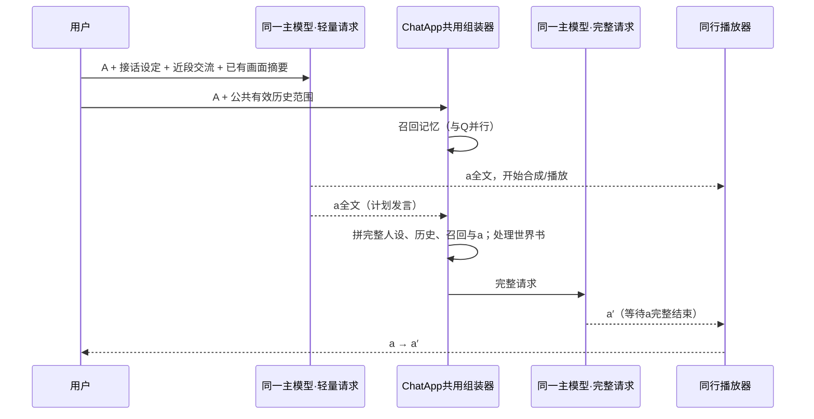

# 同行 demo

从远端 master `5c4aa521` 开始的同行 demo，现整理到独立分支 `codex/companion-api-guide`，包含同行、调试面板及 API 注册配置引导。没有继承此前本地合并和旧代码修改。桌面新增「同行」，入口 `apps/CompanionApp.tsx`。不修改 CallApp、视频演出或通话记录。原设计与对话例子见 [角色陪逛方案](../plans/character-shopping-companion.md)。

## 怎么试

1. 桌面进入「同行」并选择角色。点顶部「API 接入」，查看当前配置、注册平台、获取 Key 并跳到对应设置；已有角色主对话 API 可沿用。
2. 开始前可在右上角编辑「接话设定」：建议写语气、称呼、关系和必须遵守的设定。默认只是人设开头最多 1600 字的摘录，不是模型总结。
3. 直接输入一句话就能验证 a → a′。连续听可在「API 接入 → 听你说话」选择浏览器识别或豆包流式识别 2.0；选择豆包后填写新版语音控制台的 API Key，保存，再点「连续听」。默认仍使用原有浏览器识别，不自动切换服务商。
4. 有角色音色和对应 TTS Key 时沿用原音色；没有则明确使用文字模式。ElevenLabs 使用现有流式 PCM，其他已接入服务商按短段合成播放。
5. 在同行「API 接入 → 理解一段视频」填写独立视频 API，再点「开启镜头」。优先后摄、不镜像；每段约 8 秒的完整无声 MP4 通过 `video_url` 发送，不再用连续截图冒充视频。首次没有摘要时角色必须承认尚未看清，不等待视频理解阻塞接话。
6. 主模型是否支持图片由用户判断。「主对话模型支持图片」默认关闭；开启后长回复可附同一视频的 1–3 张截图。也可选择独立识图补充细节，此时主模型仍只收文字。两项互斥，仅本次同行生效，换角色后重新确认；都不开则不提取、不发送截图，也不调用辅助识图。

本地开发：`pnpm dev --host 127.0.0.1 --port 5199`。主应用为 `/`，独立模拟页为 `/test/fixtures/companion.html`。模拟页只验证 UI 和调度，不访问生产存档、不使用真实模型凭据；固定示例回复不代表实际生成质量。

## API 注册与配置引导

「API 接入」为同行内的独立全屏引导，设置页也有入口。打开引导不发连通测试或模型请求；“已填写”不等于验证成功。独立视频配置保存在 `APIConfig.companionVideoApi`，沿用系统设置存储与备份，不改对话、识图或语音配置。Key 输入使用密码框，已存 Key 不回填到表单，留空保留；换地址不会携带旧 Key。保存视频配置、切换截图方式或站内跳转会停止看听和旧轮请求。切换语音平台指引不会更换实际引擎。

| 用途 | 填写位置 | 引导行为 |
| --- | --- | --- |
| 短回复与长回复 | 设置 → API 配置，或神经链接 → 当前角色 → 设定 → 独立 API | 显示实际使用的模型和配置来源；角色有独立 API 时，主按钮打开该角色，不误导用户修改全局配置 |
| 视频理解 | 同行 → API 接入 → 理解一段视频 | 可选豆包 / MiniMax / 智谱 / 自定义，每家独立协议、默认地址、模型示例和官方注册链接；均直接发送 MP4 Base64；智谱标为直传试用，未验证国内接口实际兼容性 |
| 补充截图 | 同行内选择直发主模型，或设置 → 识图 API | 默认不发图。主模型支持图片由用户显式确认；辅助识图只处理视频分析后的截图，不能代替视频理解 |
| 角色语音 | 设置 → 其他 API；神经链接 → 当前角色 → 设定 | 自动展开语音设置；按 ElevenLabs / MiniMax / Fish 提供注册、Key、音色字段和保存步骤 |
| 连续语音输入 | 同行 → API 接入 → 听你说话 | 浏览器识别无需 Key；豆包提供注册、开通、语音 Key 管理入口，以及小时版 / 并发版选择；独立保存到 `APIConfig.companionStt` |

官方入口按 2026-11-17 文档核对，链接集中在 `utils/companion/setup.ts` 与 `utils/companion/videoProviders.ts`，没有邀请码，不向站外链接附带用户配置。需要登录的控制台只能确认官方入口与跳转，未替用户登录或创建账号。

- 百炼：[注册 / 控制台](https://bailian.console.aliyun.com/)、[获取 API Key](https://help.aliyun.com/zh/model-studio/get-api-key)、[视频理解](https://help.aliyun.com/zh/model-studio/vision)、[地域地址](https://help.aliyun.com/zh/model-studio/base-url)。视频文档包含完整 MP4 Base64 `video_url` 示例；按账户、地域和空间填写支持视频文件输入的模型，不猜测模型能力。
- 智谱：[注册 / 登录](https://open.bigmodel.cn/)、[模型 API Keys](https://bigmodel.cn/usercenter/proj-mgmt/apikeys)、[快速开始](https://docs.bigmodel.cn/cn/guide/start/quick-start)、[GLM-5.3-Flash](https://docs.bigmodel.cn/cn/guide/models/vlm/glm-5.3-flash)。Base URL 为 `https://open.bigmodel.cn/api/paas/v4`。当前仅保留视频直传试用；国内接口的 Base64 兼容性未实测。
- ElevenLabs：[注册](https://elevenlabs.io/app/sign-up)、[API Keys](https://elevenlabs.io/app/developers/api-keys)、[鉴权文档](https://elevenlabs.io/docs/api-reference/authentication)。原 `settings/api-keys` 跳到 `developers/api-keys`，引导使用新路径。
- MiniMax：[国内平台](https://platform.minimax.cn/)、[国内 Key 控制台](https://platform.minimax.cn/console/keys)、[海外平台](https://platform.minimax.io/)。国内旧控制台地址会跳到新域名；账号地区与应用中所选服务器需一致。
- Fish Audio：[注册](https://fish.audio/auth/signup/?redirect=/app/)、[API Keys](https://fish.audio/app/api-keys/)、[官方接口指引](https://docs.fish.audio/api-reference/introduction)。角色填写 Reference ID。
- 豆包视频：[方舟控制台](https://console.volcengine.com/ark/)、[模型 API Keys](https://ark.volcengine.com/region:cn-beijing/apikey)、[视频理解文档](https://console.volcengine.com/ark/region:cn-beijing/docs/video-understanding)。与下方豆包语音是两套能力，不能混填 Key。

### 豆包连续语音识别

官方依据：[流式识别 WebSocket](https://docs.volcengine.com/docs/doubao-voice/bidirectional-streaming-automatic-speech-recognition-websocket?lang=zh)、[二进制协议](https://www.volcengine.com/docs/6561/1354869)、[新版控制台开通指引](https://docs.volcengine.com/docs/doubao-voice/quick-start-new-console?lang=zh)。这是开放平台的 STT 接口，不能保证与豆包输入法使用同一模型或得到完全相同的识别效果。

1. 用户在[语音控制台](https://console.volcengine.com/speech/new/overview)开通「豆包流式语音识别模型 2.0」，在 [API Key 管理](https://console.volcengine.com/speech/new/setting/apikeys?projectName=default)创建 Key。同行默认小时版 `volc.seedasr.sauc.duration`；已有并发资源可选 `volc.seedasr.sauc.concurrent`。
2. 点击连续听时申请麦克风，AudioWorklet 将音频转换为 16 kHz、单声道、PCM16 小端，每 200 ms 发一个分包。使用 `bigmodel_async` 双向流式接口，开启二遍识别与 `show_utterances`；句末静音阈值 800 ms 是请求参数，不是总响应时延承诺。
3. 非空临时识别立即走同行 `interrupt()`，停止正在播放的 a / a′ 并取消旧请求。`definite: true` 的句子才交给现有 `send()`；完整快照中的旧句去重。若同一快照含已确认的前半句和仍在说的后半句，合并等后半句确认后再提交。
4. 例：角色正在说 a′，用户插话“等一下，这件有点贵”。临时文字到达即停播；确认后作为新的用户 A，短回复请求与完整上下文准备仍并行。STT 不调用主模型、不召回记忆、不改角色音色，也不新增另一条发言管线。

浏览器 WebSocket 不能自行设置豆包要求的鉴权请求头，因此使用固定上游的无存储转发：浏览器首帧携带 Key / 规格，转发端添加 `X-Api-Key` 等请求头，音频与响应按二进制传递。Key 不进入 URL；不写文件、数据库、对象存储或内容日志，不生成录音链接。音频和 Key 会经过该转发端，再送给豆包；不能称为完全本地识别或承诺服务商零留存。用户自己的 Key 保存在本机设置，并随系统配置备份。

- **本地开发与预览**：Vite 的 `/doubao/asr` WebSocket 入口由 `server/doubao-asr-middleware.ts` 提供，只接受当前监听地址的同源浏览器连接；升级代码后需重启 Vite。用户不填任何服务地址。
- **线上**：复用 `getProxyWorkerUrl()` 选中的主代理。维护者需更新 `worker/index.js`（可用 `pnpm build:proxy` 生成单文件），不新增 Worker、Bucket 或持久凭据。旧代理没有此路由时明确报错，不偷偷切回浏览器识别；本轮未部署线上代理。
- **停止与失败**：暂停、离开、换角色、切后台、保存识别设置会停止麦克风和连接；用户取消后才返回的权限流也立即释放。连接超时、积压、服务错误或断线均停止并提示，不自动重试产生费用。单连接上限 30 分钟，到时手动重新开启。
- **回声与环境**：浏览器请求回声消除、降噪与自动增益，但不能保证消除角色外放声音，建议戴耳机。真实识别准确率、弱网和移动端后台行为需带 Key 实测。

实现分别位于 `doubaoListening.ts`（设备与生命周期）、`doubaoProtocol.ts`（协议 / 确认句去重）、`doubaoPcm.worklet.js`（音频分包）及主 Worker 的 `attachDoubaoAsrRelay`（本地 / 线上共用）。不接入 CallApp。

### 三家视频协议

未配置时表单默认展示豆包草稿，选择平台会填写参考地址/模型，必须手动保存后才生效。旧配置没有 `provider` 时保留自定义 Base64 协议，不根据域名或模型名自动迁移。切平台清空草稿 Key，换地址不带旧 Key。已删除上传服务、地址和口令字段，载入/导入/保存 API 配置时丢弃旧上传配置。打开或切换引导不调用 API。

| 平台 | 默认配置 | 视频请求参数 |
| --- | --- | --- |
| 豆包 | `https://ark.cn-beijing.volces.com/api/v3` / `doubao-seed-2-1-pro-260915` | 完整 MP4 Base64 `video_url.url`，`fps: 1`，`thinking.type: disabled`，`max_completion_tokens: 1200` |
| MiniMax 国内 | `https://api.minimax.cn/v1` / `MiniMax-M3.1-Flash` | 完整 MP4 Base64，`fps: 1`，`reasoning_effort: low`，`reasoning_split: true`，`max_completion_tokens: 4096`；不发送 temperature 或禁用思考参数，M3.1 Flash 必须思考 |
| 智谱（试用） | `https://open.bigmodel.cn/api/paas/v4` / `glm-5.3-flash` | 完整 MP4 Base64，`max_tokens: 4096`，默认型号不禁用思考；旧配置的 GLM-4.6V 仍保留关闭思考参数，但不自动换用户模型，也不保证旧型号能直传 |
| 自定义 | 保留用户原有地址和模型 | 原 Base64 协议、`max_tokens: 1000`，适用于已确认支持此输入的兼容平台 |

依据：[豆包 Chat 思考控制](https://console.volcengine.com/ark/region:cn-beijing/docs/deep-thinking)、[MiniMax OpenAI 兼容 API](https://platform.minimax.cn/docs/api-reference/text-chat-openai)、[智谱 Chat 完整 schema](https://docs.bigmodel.cn/api-reference/模型-api/对话补全.md)。模型 ID 可编辑，账号需要先开通相应模型；所列默认值不保证账号已获权限。视频理解都限制 45 秒，空正文不拿 reasoning 冒充观察。

同行不提供或要求自建视频存储。三家都将内存中的完整 MP4 编码进模型请求；失败时不改走临时链接、不回退截图。智谱的依据是[官方 ZCode 的视频 Base64 序列化实现](https://github.com/zai-org/ZCode/blob/main/patches/@ai-sdk__openai-compatible@2.0.60.patch)，这能证明官方客户端存在此传输方式，但不能证明国内标准 API / 每个模型都接受；因此标记直传试用。其官方 API schema 仍只写视频 URL，国内实际兼容性与延迟留待实测。视频仍发给用户选择的模型服务商，服务商保留政策独立于 SullyOS；不能称为完全本地推理或保证对方零留存。

最初引导版本曾通过 9 文件 / 24 用例，覆盖打开引导不生成、切换指引不改配置、按当前角色跳转、跨 App 前取消旧轮及设置定位。本轮完整验证结果见下文。模拟页不会跳转到真实设置；站内导航在主应用生效。

## 同行内的调试面板

输入框上方的「本轮调试」默认收起。展开后可跟随最新一轮，或选看最近 5 轮，包括被打断的轮次。仅保留本页内存，离开或换角色即清空；展开、收起和切换轮次不触发模型调用，不需要开启全局日志采集。

- **统一时间线**：每轮以 `performance.now()` 为零点，列出开始、结束和耗时；短回复请求、记忆召回、完整上下文准备、长回复请求用同一比例的横条展示。完整准备还拆出收件箱/历史/素材读取、召回后等待 a 全文、人设提示词组装、协同和任务上下文。完整准备包含子阶段，不能把所有数字相加。跳过召回、召回失败和未进入召回分别标注。
- **发言衔接**：分别记录准备语音到首次出声、实际播放、a 结束后等待 a′ 文本、a′ 文本提前就绪后等待 a 结束。a 提前播完、但完整上下文仍在准备时，也计入等待 a′ 文本。两段语音的衔接空隙是 a 播放结束到 a′ 首次出声，包括剩余准备、生成和 TTS 等待。文字模式明确标为不适用，不冒充 0 秒语音延迟。
- **实际提示词**：保存传给 `safeFetchJson` 的同一份序列化请求体，逐条展开 system / user / assistant，显示模型及参数、生成的正文，并可手动复制完整 JSON。长请求中的 a 是该次实际发送的 assistant 消息。快照不含 URL、请求头或 API Key；原生模型的协议转换仍由共享适配器完成，这不是底层网络抓包。未提交的长请求不预造一份“实际提示词”。
- **首段正文**：使用共享 SSE 解析器的首段正文事件，显示距提交请求的时间；整包响应或没有该事件时标为未观测到，不用请求完成时间假充首字时间。
- **打断**：正在运行的阶段截至打断时冻结并标注；未执行阶段不画成 0 秒。旧请求即使忽略取消、晚些返回，也不会修改已结束记录或污染新一轮。

例：短回复请求 `0–5s`，召回 `0.2–6s`，a 准备语音 `5–6s`、播放 `6–35s`，完整提示词在 `7s` 就绪，长回复生成 `7–42s`，a′ 在 `44s` 出声。面板应显示短回复与召回重叠 `4.8s`，a 播放与长回复生成重叠 `28s`；a 结束后等待长文本 `7s`，再等语音 `2s`，总衔接空隙 `9s`。若长文本在 `30s` 就绪，则显示它等待 a 结束 `5s`，这段等待不算静音空隙。数字只是读图示例，没有固定生成或播放时长。

PCM 首次出声按播放器时钟约每 80ms 采样；MP3 使用 `playing` 事件。它们是浏览器播放侧的计时，不是麦克风测量的声学延迟。播放阶段包含分段合成/网络造成的间隙，不把它解释为纯音频时长。模拟页不调用真实请求管线，因此不会伪造模型请求、召回和提示词记录；这些需在主应用实测。

## 请求与发言时序

- URL / Key / Model 在会话开始时一次解析，a 和 a′ 使用相同配置，不切快模型，不设置 20 / 40 秒播放配额。
- 轻量路径由 `ContextBuilder.buildCompanionQuickRequest` 明确隔离，不触发完整上下文读取，也不等待记忆召回。只保留本次同行最近七条已展示/已播出的交流；当前用户输入完整保留，更早的长消息最多取末尾 600 字并标明节选，避免长续答把快提示词越撑越大。这不改变完整路径的历史范围。
- 完整路径调用 `loadCharacterContextRange` 和 `buildChatRequestPayload`。手动模式仍按角色 `contextLimit`，自动模式仍按记忆水位及用户断点，不额外截成 200 条；本次临时交流参与同一范围筛选。
- `appPrompt.prepareMessages` 是公共组装器新增的可选延后材料接口：召回后、世界书扫描与深度放置前等待 a。原 App 没有提供此项，流程保持原样。a 不送回召回再查一次，也不把上一轮召回缓存复用为本轮结果。
- a 以独立 assistant 消息只进入本轮长请求一次。系统说明它是计划播放/正在播放的文字，a′ 接在完整 a 之后，不假定用户已回答其中的问题。长回复和 ChatApp 共用记忆、世界书和历史清洗，玩法及输出指令使用同行规则；demo 不提供 ChatApp 工具执行循环。
- 请求日志显式归属「同行／轻量接话／完整上下文续答／视频片段理解／视频截图辅助识图」。没有新增内容埋点。

## 视频与主模型的分工

2026-11-17 修正验收：同行、设置导航及共享请求组装器共 12 个测试文件、65 项通过，覆盖完整视频载荷、截图显式授权、独立凭据、并行录制和只保留最新片段、取消后迟到结果、视频成功但截图失败、配置保存不携带旧地址的 Key。定向 TypeScript 检查在本轮修改文件中无诊断，共享依赖仍有既有错误。生产 Vite 构建通过，先在隔离目录构建再更新原 5175 预览，保留旧哈希资源；新旧入口脚本、好友圈旧分块、恢复页及 SW 均验证 HTTP 200。浏览器模拟页验证了视频配置表单、默认无图以及勾选/取消的界面行为，无控制台错误；未提供真实摄像头或付费模型端到端结果。

`capture.ts` 每次重新启动 MediaRecorder，产生可独立解码的 MP4；不把一次录制的后续 timeslice 块当完整视频。约 640px、12fps、700kbps，单段最多 8 MB。浏览器不支持 MP4 时明确报错，不偷偷改成截图。当前录制不带声音，连续听独立走用户选择的浏览器或豆包 STT。

录制下一段与分析上一段并行；最多一个视频分析请求和一个待处理片段，待处理只保留最新完整片段，避免分析队列无限延后。一次失败可随下一段再试，连续两次失败暂停镜头；停止镜头、换角色、后台暂停或退出均取消采集、待处理片段和请求，晚到结果不发布。

视频模型先返回时序摘要和 1–3 个建议关键帧秒数。摘要立即可用于短接话，无需等截图。只有显式选择补充图片时，才解码同一段视频并按有效秒数提图；未返回有效秒数时仅取末尾一帧，不声称是模型选出的关键帧。选择辅助识图时将截图描述追加到摘要，截图提取或辅助识图失败仍保留视频摘要并显示提示。

长回复在公共组装器等待 a 的位置固定一份视频摘要及匹配截图快照，完成原有上下文/记忆/世界书组装后，仅给这条观测消息加图片，不重发旧聊天图片，不改变 a 的位置和次数。默认模式的主模型请求里没有 `image_url`；只有 `direct` 显式选项会给长回复加图，短回复始终只用文字。尚未准备好的截图不会阻塞 a′，留给后续轮次。

例如：镜头先扫过红外套，随后拿起蓝外套。视频模型描述「先看红色，最后手持蓝色，袖口有白色标签」，并建议第 6 秒截图。用户说「这件怎么样」时，同一主模型先按已有摘要接话，同时召回记忆。a 全文到达后完整组装 a′：不开图片时只有这段摘要；勾选主模型识图时再加第 6 秒的截图；选辅助识图时加「标签可见棉 100%」等实际识别文字。所有模式均由原主模型继续扮演角色。

## 打断与失败

识别到非空的中间文字即打断，不等最终转写；环境噪声的 speechstart 本身不作为新轮次。文本发送、手动「打断」、切角色、离开和切后台也取消旧轮。所有请求、待播文字与音频均有同轮 AbortSignal；底层忽略取消时，回来的旧结果也不能进入下一轮。

例如 A 是「这件怎么样」，a 已说「先看一下肩线」，用户补充 B「我说的是旁边那件」：旧 a′ 丢弃，下一轮历史只有 A、a 实际说出的部分、B；未听见的「我更喜欢蓝色」不进入下一轮。b 与新的完整准备再次并行。

ElevenLabs 按字符时间轴和播放器时钟保留已播前缀；其他 MP3 服务商没有对齐数据，只把已完整播完的小段计作已听，不能伪造按百分比推算的字幕。它们已经提交的合成不能撤回计费，但迟到音频不会播放。语音错误明确提示，不静默切音色。无语音模式按已展示文字记录。

视频摘要携带片段起止时间，结束时间距今超过 20 秒标为旧观察。更新观察不会自动发起角色说话。后台暂停后需手动重新开启看听；会话文本保留至离开此 App，录像和图片在本机只短暂保留在内存，没有额外云端视频存储。若选择直发截图，最近五轮调试请求快照也会包含所发截图，离开、换角色或改视频配置/截图模式时清空。

## demo 边界与下一步

2026-11-17 按用户隐私与易用性要求撤销自建临时存储，删除上传代码、Worker、部署指引和凭据字段。视频进一步接入暂缓，本轮接入豆包语音识别。无真实视频模型端到端验证结果。

原 `http://127.0.0.1:5175/` 预览已用隔离产物更新，保留旧哈希资源。新入口、上一版入口、旧好友圈分块、恢复页和 SW 均验证 HTTP 200；没有注销 SW 或清理本机存档。

- 当前接的是完整视频片段理解，不是持续流式视频会话。豆包 / MiniMax 与自定义兼容接口使用 MP4 Base64，智谱仅保留直传试用；不提供云存储或厂商文件 ID 模式。没有真实服务凭据时不能声称视频理解质量、CORS 或延迟已验证。
- 浏览器与豆包 STT 的可用性、网络依赖、分句速度和扬声器回声因环境不同。建议耳机测试。豆包 WebSocket STT 已接入，移动端稳定性、回声消除和真实外出弱网仍待实测。
- 镜头移动会刷新观察，但当前没有自动判断“用户已经改看另一件商品”并只取消 a′ 的机制。需要用户插话/打断；不能把摘要更新等同于完成场景有效性校验。
- 本次同行文字留在内存，尚无持久会话、跨 App 回流和长期记忆提取。完整请求会读取已有的共享记忆，读取与写回是不同能力。
- 接话设定暂不持久化；默认摘录可能漏掉角色卡后部约束，应在开始前编辑。后续可做可审阅的角色会话卡缓存，不能每轮增加一次摘要模型请求。
- 主模型仍可能本身很慢。缩短输入、并行召回不保证固定首响时间；语音越长越能覆盖生成等待，但不要让角色为拖时间说空话。
- 本轮 17 文件 / 95 用例通过，包含真实本机 WebSocket 握手、协议原始 / gzip 响应、44.1 / 48 kHz 分包、确认句去重、取消后权限返回、错误与背压收音释放、界面配置及原有 a → a′ 调度；执行 `pnpm vitest run utils/companion/ utils/apiConfigNormalize.test.ts utils/chatRequestPayload.test.ts utils/settingsNavigation.test.ts worker/doubao-asr.test.ts --silent`。生产 Vite 与单文件代理构建通过；定向类型检查在本轮文件中无诊断，共享依赖仍有既有错误。浏览器模拟页已检查豆包配置表单和官方入口，无控制台错误，截图在 `output/companion-setup/doubao-stt.jpg`。没有用真实 Key 调用 STT、视频或 TTS，也未发布线上代理。

验证入口：`utils/companion/*.test.ts`、`utils/chatRequestPayload.test.ts`、`utils/contextWorldbook.test.ts`、`utils/contextPipeline.test.ts`、`utils/homeChatPipelineParity.test.ts`。

本轮 8 个相关测试文件共 61 条用例通过（60 条整组回归后，新增轻量历史预算用例并重跑对应文件）。覆盖同一模型路由、单次召回、a 的世界书深度、超过 200 条自动范围、手动条数、播放与生成重叠、打断后已听前缀、迟到结果、识别中间结果与取消后摄像头权限回程。组件测试使用 Node 24；本机 Node 22.13 缺少已安装 jsdom/undici 所需的压缩接口。源码类型检查仍有仓库既有错误（如房间衣装类型），本轮修改文件没有类型诊断；不把 Vite 构建通过等同于全仓 TypeScript 检查通过。

后续调试面板验证：`pnpm vitest run utils/companion/ utils/chatRequestPayload.test.ts --silent` 共 8 文件、45 用例通过，覆盖原样请求快照、真实首段事件、跳过召回、并行重叠、两种等待顺序、打断冻结、轮次切换和 PCM/MP3 出声事件；`pnpm exec vite build` 通过。定向 TypeScript 检查在同行修改文件中没有诊断，共享依赖仍有既有错误。此次已在浏览器模拟页检查展开布局、完整一轮文字衔接及调试记录，页面无控制台错误；没有调用真实模型或 TTS，真实服务的延迟留待主应用实测。
