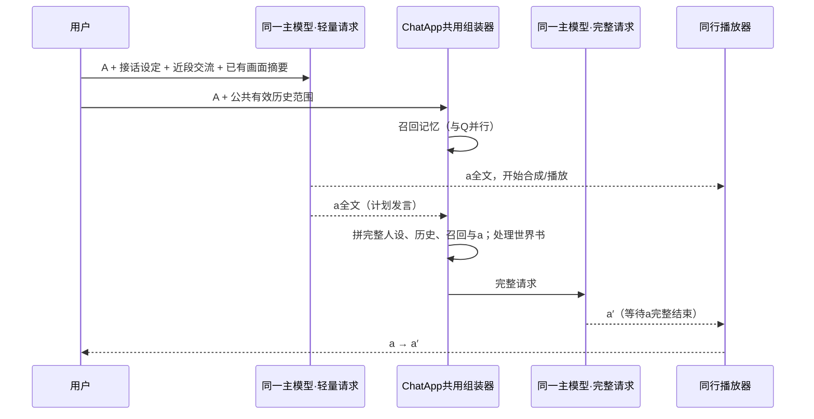

# 同行 demo

从远端 master `5c4aa521` 开始的同行 demo，现整理到独立分支 `codex/companion-api-guide`，包含同行、调试面板及 API 注册配置引导。没有继承此前本地合并和旧代码修改。桌面新增「同行」，入口 `apps/CompanionApp.tsx`。不修改 CallApp、视频演出或通话记录。原设计与对话例子见 [角色陪逛方案](../plans/character-shopping-companion.md)。

## 怎么试

1. 桌面进入「同行」并选择角色。点顶部「API 接入」，查看当前配置、注册平台、获取 Key 并跳到对应设置；已有角色主对话 API 可沿用。
2. 开始前可在右上角编辑「接话设定」：建议写语气、称呼、关系和必须遵守的设定。默认只是人设开头最多 1600 字的摘录，不是模型总结。
3. 直接输入一句话就能验证 a → a′。连续听使用浏览器 SpeechRecognition，不支持的环境提供文字输入；中文识别，稳定 final 后短暂合句再发送。
4. 有角色音色和对应 TTS Key 时沿用原音色；没有则明确使用文字模式。ElevenLabs 使用现有流式 PCM，其他已接入服务商按短段合成播放。
5. 在系统「识图 API」配置并开启独立识图后，点「开启镜头」。优先后摄、不镜像；每 2.5 秒采样，最多留三帧，每隔至少 8 秒且没有未完成请求时识别一次。首次没有摘要时角色必须承认尚未看清，不等待识图阻塞接话。

本地开发：`pnpm dev --host 127.0.0.1 --port 5199`。主应用为 `/`，独立模拟页为 `/test/fixtures/companion.html`。模拟页只验证 UI 和调度，不访问生产存档、不使用真实模型凭据；固定示例回复不代表实际生成质量。

## API 注册与配置引导

「API 接入」为同行内的独立全屏引导，设置页也有入口。它读取本机配置状态，不发连通测试或模型请求、不保存或显示 Key；“已填写”不等于验证成功。切换平台指引不会更换实际语音引擎。站内跳转会先停止看听和旧轮请求，再定位设置；返回同行需重新开始。关闭引导使用原来的返回层级，回到同行。

| 用途 | 填写位置 | 引导行为 |
| --- | --- | --- |
| 短回复与长回复 | 设置 → API 配置，或神经链接 → 当前角色 → 设定 → 独立 API | 显示实际使用的模型和配置来源；角色有独立 API 时，主按钮打开该角色，不误导用户修改全局配置 |
| 摄像头观察 | 设置 → 识图 API | 自动展开并滚动到识图板块；提供可复制的智谱 Base URL 与 `glm-4.6v` 示例；先保存并测试，再开镜头 |
| 角色语音 | 设置 → 其他 API；神经链接 → 当前角色 → 设定 | 自动展开语音设置；按 ElevenLabs / MiniMax / Fish 提供注册、Key、音色字段和保存步骤 |
| 连续语音输入 | 浏览器麦克风与语音识别 | 不需要 API Key；豆包明确显示“尚未接入”，只提供资料与控制台入口，不提供无效配置表单 |

官方入口按 2026-11-17 文档核对，链接集中在 `utils/companion/setup.ts`，没有邀请码，不向站外链接附带用户配置。需要登录的控制台只能确认官方入口与跳转，未替用户登录或创建账号。

- 智谱：[注册 / 登录](https://open.bigmodel.cn/)、[模型 API Keys](https://bigmodel.cn/usercenter/proj-mgmt/apikeys)、[快速开始](https://docs.bigmodel.cn/cn/guide/start/quick-start)、[GLM-4.6V 图像理解](https://docs.bigmodel.cn/cn/guide/models/vlm/glm-4.6v)。示例 Base URL 为 `https://open.bigmodel.cn/api/paas/v4`；标准 API Key 与套餐 Key 分开管理，按账户权限选择模型。
- ElevenLabs：[注册](https://elevenlabs.io/app/sign-up)、[API Keys](https://elevenlabs.io/app/developers/api-keys)、[鉴权文档](https://elevenlabs.io/docs/api-reference/authentication)。原 `settings/api-keys` 跳到 `developers/api-keys`，引导使用新路径。
- MiniMax：[国内平台](https://platform.minimax.cn/)、[国内 Key 控制台](https://platform.minimax.cn/console/keys)、[海外平台](https://platform.minimax.io/)。国内旧控制台地址会跳到新域名；账号地区与应用中所选服务器需一致。
- Fish Audio：[注册](https://fish.audio/auth/signup/?redirect=/app/)、[API Keys](https://fish.audio/app/api-keys/)、[官方接口指引](https://docs.fish.audio/api-reference/introduction)。角色填写 Reference ID。
- 豆包：[语音控制台](https://console.volcengine.com/speech/service)、[开通文档](https://docs.volcengine.com/docs/doubao-voice/console-guidance?lang=zh)。当前 demo 不消费豆包凭据，不要求预先充值。

测试：`pnpm vitest run utils/companion/ utils/settingsNavigation.test.ts --silent`，9 文件共 24 用例通过，覆盖打开引导不生成、切换指引不改配置、按当前角色跳转、跨 App 前取消旧轮、识图/语音板块挂载前请求与已挂载重复定位，以及原有同行调度。生产 Vite 构建通过；定向类型检查在本次同行与设置导航文件中没有诊断，共享依赖仍有仓库既有类型错误。2026-11-17 的浏览器自动化初始化超时，新的引导未完成视觉验收。模拟页不会跳转到真实设置；站内导航在主应用生效。

## 同行内的调试面板

输入框上方的「本轮调试」默认收起。展开后可跟随最新一轮，或选看最近 5 轮，包括被打断的轮次。仅保留本页内存，离开或换角色即清空；展开、收起和切换轮次不触发模型调用，不需要开启全局日志采集。

- **统一时间线**：每轮以 `performance.now()` 为零点，列出开始、结束和耗时；短回复请求、记忆召回、完整上下文准备、长回复请求用同一比例的横条展示。完整准备还拆出收件箱/历史/素材读取、召回后等待 a 全文、人设提示词组装、协同和任务上下文。完整准备包含子阶段，不能把所有数字相加。跳过召回、召回失败和未进入召回分别标注。
- **发言衔接**：分别记录准备语音到首次出声、实际播放、a 结束后等待 a′ 文本、a′ 文本提前就绪后等待 a 结束。a 提前播完、但完整上下文仍在准备时，也计入等待 a′ 文本。两段语音的衔接空隙是 a 播放结束到 a′ 首次出声，包括剩余准备、生成和 TTS 等待。文字模式明确标为不适用，不冒充 0 秒语音延迟。
- **实际提示词**：保存传给 `safeFetchJson` 的同一份序列化请求体，逐条展开 system / user / assistant，显示模型及参数、生成的正文，并可手动复制完整 JSON。长请求中的 a 是该次实际发送的 assistant 消息。快照不含 URL、请求头或 API Key；原生模型的协议转换仍由共享适配器完成，这不是底层网络抓包。未提交的长请求不预造一份“实际提示词”。
- **首段正文**：使用共享 SSE 解析器的首段正文事件，显示距提交请求的时间；整包响应或没有该事件时标为未观测到，不用请求完成时间假充首字时间。
- **打断**：正在运行的阶段截至打断时冻结并标注；未执行阶段不画成 0 秒。旧请求即使忽略取消、晚些返回，也不会修改已结束记录或污染新一轮。

例：短回复请求 `0–5s`，召回 `0.2–6s`，a 准备语音 `5–6s`、播放 `6–35s`，完整提示词在 `7s` 就绪，长回复生成 `7–42s`，a′ 在 `44s` 出声。面板应显示短回复与召回重叠 `4.8s`，a 播放与长回复生成重叠 `28s`；a 结束后等待长文本 `7s`，再等语音 `2s`，总衔接空隙 `9s`。若长文本在 `30s` 就绪，则显示它等待 a 结束 `5s`，这段等待不算静音空隙。数字只是读图示例，没有固定生成或播放时长。

PCM 首次出声按播放器时钟约每 80ms 采样；MP3 使用 `playing` 事件。它们是浏览器播放侧的计时，不是麦克风测量的声学延迟。播放阶段包含分段合成/网络造成的间隙，不把它解释为纯音频时长。模拟页不调用真实请求管线，因此不会伪造模型请求、召回和提示词记录；这些需在主应用实测。

## 请求与发言时序

- URL / Key / Model 在会话开始时一次解析，a 和 a′ 使用相同配置，不切快模型，不设置 20 / 40 秒播放配额。
- 轻量路径由 `ContextBuilder.buildCompanionQuickRequest` 明确隔离，不触发完整上下文读取，也不等待记忆召回。只保留本次同行最近七条已展示/已播出的交流；当前用户输入完整保留，更早的长消息最多取末尾 600 字并标明节选，避免长续答把快提示词越撑越大。这不改变完整路径的历史范围。
- 完整路径调用 `loadCharacterContextRange` 和 `buildChatRequestPayload`。手动模式仍按角色 `contextLimit`，自动模式仍按记忆水位及用户断点，不额外截成 200 条；本次临时交流参与同一范围筛选。
- `appPrompt.prepareMessages` 是公共组装器新增的可选延后材料接口：召回后、世界书扫描与深度放置前等待 a。原 App 没有提供此项，流程保持原样。a 不送回召回再查一次，也不把上一轮召回缓存复用为本轮结果。
- a 以独立 assistant 消息只进入本轮长请求一次。系统说明它是计划播放/正在播放的文字，a′ 接在完整 a 之后，不假定用户已回答其中的问题。长回复和 ChatApp 共用记忆、世界书和历史清洗，玩法及输出指令使用同行规则；demo 不提供 ChatApp 工具执行循环。
- 请求日志显式归属「同行／轻量接话／完整上下文续答／持续观察画面」。没有新增内容埋点。

## 打断与失败

识别到非空的中间文字即打断，不等最终转写；环境噪声的 speechstart 本身不作为新轮次。文本发送、手动「打断」、切角色、离开和切后台也取消旧轮。所有请求、待播文字与音频均有同轮 AbortSignal；底层忽略取消时，回来的旧结果也不能进入下一轮。

例如 A 是「这件怎么样」，a 已说「先看一下肩线」，用户补充 B「我说的是旁边那件」：旧 a′ 丢弃，下一轮历史只有 A、a 实际说出的部分、B；未听见的「我更喜欢蓝色」不进入下一轮。b 与新的完整准备再次并行。

ElevenLabs 按字符时间轴和播放器时钟保留已播前缀；其他 MP3 服务商没有对齐数据，只把已完整播完的小段计作已听，不能伪造按百分比推算的字幕。它们已经提交的合成不能撤回计费，但迟到音频不会播放。语音错误明确提示，不静默切音色。无语音模式按已展示文字记录。

画面摘要携带采集时效，超过 20 秒标为旧观察。更新观察不会自动发起角色说话。连续两次识图失败关闭镜头，避免配置错误时持续发请求。后台暂停后需手动重新开启看听；会话文本保留至离开此 App，图片和媒体流及时释放。

## demo 边界与下一步

- 已接连续截图观察，不是服务端原生连续视频理解；当前用独立识图摘要供任意主模型读取，不向不明视觉能力的主模型直接塞图。
- 浏览器 STT 的可用性、网络依赖、分句速度和扬声器回声因环境不同。建议耳机测试。豆包 WebSocket STT、移动端稳定 VAD/回声消除和真实外出弱网仍待接入与实测。
- 镜头移动会刷新观察，但当前没有自动判断“用户已经改看另一件商品”并只取消 a′ 的机制。需要用户插话/打断；不能把摘要更新等同于完成场景有效性校验。
- 本次同行文字留在内存，尚无持久会话、跨 App 回流和长期记忆提取。完整请求会读取已有的共享记忆，读取与写回是不同能力。
- 接话设定暂不持久化；默认摘录可能漏掉角色卡后部约束，应在开始前编辑。后续可做可审阅的角色会话卡缓存，不能每轮增加一次摘要模型请求。
- 主模型仍可能本身很慢。缩短输入、并行召回不保证固定首响时间；语音越长越能覆盖生成等待，但不要让角色为拖时间说空话。
- 本轮生产构建通过；模拟与单测不代表真实服务质量。浏览器工具因无法可靠确认 Windows 当前 URL 而终止，未完成视觉验收。没有用真实 Key 调用 STT、识图或 TTS，也未发布。

验证入口：`utils/companion/*.test.ts`、`utils/chatRequestPayload.test.ts`、`utils/contextWorldbook.test.ts`、`utils/contextPipeline.test.ts`、`utils/homeChatPipelineParity.test.ts`。

本轮 8 个相关测试文件共 61 条用例通过（60 条整组回归后，新增轻量历史预算用例并重跑对应文件）。覆盖同一模型路由、单次召回、a 的世界书深度、超过 200 条自动范围、手动条数、播放与生成重叠、打断后已听前缀、迟到结果、识别中间结果与取消后摄像头权限回程。组件测试使用 Node 24；本机 Node 22.13 缺少已安装 jsdom/undici 所需的压缩接口。源码类型检查仍有仓库既有错误（如房间衣装类型），本轮修改文件没有类型诊断；不把 Vite 构建通过等同于全仓 TypeScript 检查通过。

后续调试面板验证：`pnpm vitest run utils/companion/ utils/chatRequestPayload.test.ts --silent` 共 8 文件、45 用例通过，覆盖原样请求快照、真实首段事件、跳过召回、并行重叠、两种等待顺序、打断冻结、轮次切换和 PCM/MP3 出声事件；`pnpm exec vite build` 通过。定向 TypeScript 检查在同行修改文件中没有诊断，共享依赖仍有既有错误。此次已在浏览器模拟页检查展开布局、完整一轮文字衔接及调试记录，页面无控制台错误；没有调用真实模型或 TTS，真实服务的延迟留待主应用实测。
