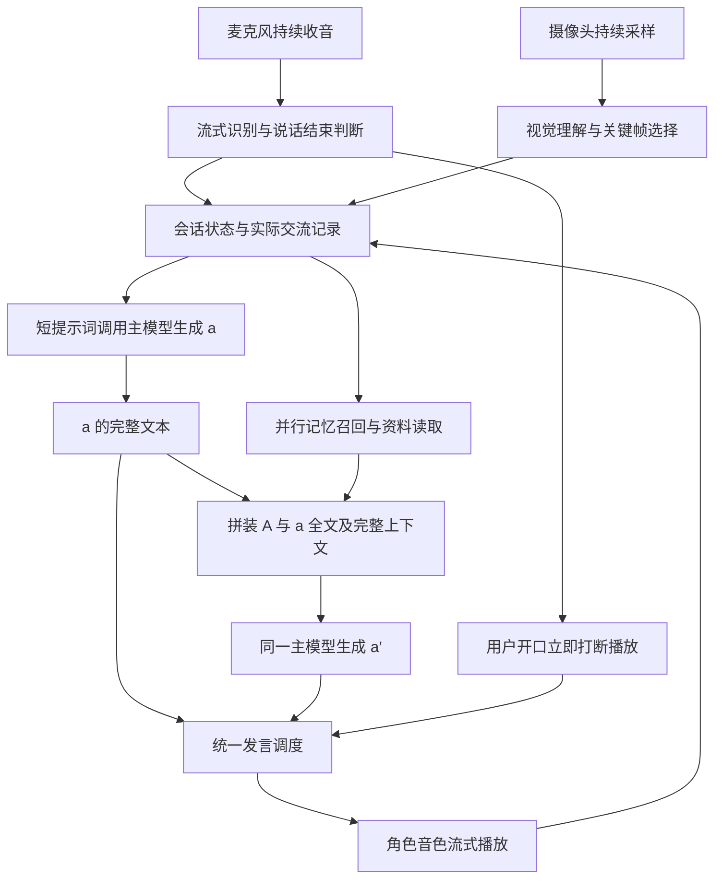

# 角色陪逛交互方案

日期：2026-11-14。状态：独立「同行」App demo 已落地；下面的完整体验设计仍包含待验证能力。实现边界见 [同行 demo](../docs/companion-demo.md)。

用户开启摄像头和麦克风后，角色能够持续了解眼前的环境，与用户保持语音交流。用户说 A 后，同一个角色主模型先用短提示词生成回复 a，同时独立进行记忆召回；a 的文字生成完成后，开始播放语音，并把 A、a 全文、召回结果及其他完整上下文交给同一主模型生成后续回复 a′。播放 a 的时间用于覆盖 a′ 的生成，用户听到的是同一个角色连续陪伴自己。

本方案确定交互与上下文协作方式，保留供应商选型和性能参数的验证空间。用户后续确认开始做独立 App，不接入视频通话。

## 已确定的方向

| 项目 | 约定 |
| --- | --- |
| 角色主模型 | 快回复与完整回复使用同一套 URL、Key、Model；短提示词是加快接话的主要手段 |
| 快回复 a | 用短提示词先按角色风格回应，不等待本轮记忆召回；语音长短随内容决定，讲到约 40 秒也可以 |
| 记忆召回 | 用户说 A 后，与 a 的文字生成同时启动；召回结果给后续完整请求使用 |
| 完整回复 a′ | a 全文与召回结果就绪后，立即通过 ContextBuilder 拼装完整提示词和上下文并开始生成，和 a 的语音播放重叠 |
| 衔接上下文 | a 的全文直接进入 a′ 的请求，让 a′ 接着 a 展开；不必等 a 播完才提供这段文字 |
| 等待期间 | 摄像头和麦克风继续工作，用户可以插话，角色可以继续接话 |
| 后续回应 | 根据最新对话决定何时说、说多少，也可以只更新状态，不强制再说一遍 |
| 语音输出 | 沿用当前角色选定的音色和 TTS 配置，所有发言共用一个播放调度器 |

“短回复”主要指输入提示词精简、先生成的这段回应，不设固定的语音秒数或字数。内容合适时可以讲约 40 秒，也可以更短；不人为延长停顿、语速或无关内容。

本次讨论对记忆召回的估计是约 4–7 秒。这段时间与 a 的文字生成重叠，a 不承担召回等待。主时序预期在开始播放 a 时，召回已完成，完整提示词可以迅速组装并提交，接下来播放期间进行的是 a′ 的生成。4–7 秒是待实测的估计，召回、上下文组装和完整回复生成的耗时分别记录。

初版限定为手机前台、单角色的陪逛会话，入口为独立「同行」App。会话、摄像头、识别和播音调度均独立于 CallApp；锁屏后持续运行和原生端能力另行验证。

## 整体流程

主要重叠关系有两段：a 的文字生成与记忆召回并行；a 的语音播放与 a′ 的生成并行。单轮正常路径里，a′ 等 a 全文就绪后再请求，并不要求两个角色生成请求同时启动。声音始终只有一个出口。持续感知更新会话状态，不因每一帧、每个识别中的字就发起新的角色生成请求。

### 一轮交流的时序

| 阶段 | 快路径 | 完整路径 | 感知与播放 |
| --- | --- | --- | --- |
| 用户正在讲话 | 可以准备本地输入，不依据易变的转写抢答 | 可预热稳定配置，不把临时识别当作确定问题 | 持续收音、识别和观察 |
| 用户话语 A 确定 | 立即用会话卡、A 和已有视觉摘要生成 a，不调用本轮记忆召回 | 并行召回 A 所需的记忆，读取有效历史及其他必要资料 | 摄像头和麦克风继续运行 |
| a 生成期间 | 持续生成 a 的文字 | 约 4–7 秒的召回尽量在此阶段完成，保留结果供后续组装 | 不因召回尚未完成而阻塞 a |
| a 全文就绪 | 送入 TTS，语音可流式播放，无需等整段音频合成完 | 召回已完成时，立即拼入 A、a 全文、召回结果和完整上下文，开始生成 a′ | 播放 a 与完整请求组装、提交在同一阶段推进 |
| a 播放期间 | 保留 a 的发言计划并接受打断 | a′ 已在生成；若用户补充或更正，则检查原请求是否还适用 | 更新实际播出进度，不把未播部分当作已经说过 |
| a′ 到达 | 不再为同一问题追加无必要的快回复 | 检查适用性、重复内容和对 a 的依赖 | 默认在 a 播完后接着播放 a′；用户讲话时先听 |

本方案把“a 的文字生成完成”和“a 的语音播放完成”分开：前者就足以把 a 拼进长回复的上下文，不等待后者。为了明确依赖，主时序按 a 全文完成后开始播音设计，TTS 自身仍采用流式输出。

a′ 最早可在“a 全文完成”和“召回及必要资料就绪”两者中较晚的时点，加上最终组装时间后发起。若召回比 a 更早完成，它的约 4–7 秒等待就被 a 的生成覆盖。若 a 更早完成，先播放 a，召回随后完成就立即组装并生成 a′；不会为了等记忆而延迟 a 出声。

a 播放结束而 a′ 仍未就绪时，用户可以继续交流，需要时再接话；没有新内容时允许安静陪伴。不要把未到的后续答案替换成循环填充话术。

## 短提示词如何保留角色

### 提前准备会话卡

进入陪逛时，从统一角色上下文来源准备一份精简会话卡。核心是角色的表达风格，同时保留维持身份和互动所必需的信息。

| 信息 | 快路径保留的内容 |
| --- | --- |
| 表达风格 | 语气、常用句式、表达亲近或幽默的方式，以及明确的表达禁忌 |
| 身份与关系 | 角色和用户的身份、称呼、当前关系阶段、不能违背的设定 |
| 当前状态 | 正在一起做什么、当前情绪、尚未回答的问题 |
| 当下事实 | 最新视觉摘要、用户刚明确说过的要求、已经确认的事实 |
| 最近交流 | 本次会话最近几轮用户话语与角色实际发言 |

静态部分以几百字为压缩起点；具体长度服从角色复杂度，不能为了凑长度删掉必要身份或约束。a 不发起或等待本轮记忆召回，使用已有会话卡和本轮可直接取得的信息。为 A 发起的召回独立并行，结果只在组装 a′ 时使用；完整长期经历和庞大历史不进入 a 的等待链路。

需要模型帮助提炼风格时，在进入会话或后台更新时完成，不在每次接话前再做一次压缩调用。角色、用户身份、关系或关键设定变化时使旧卡失效；切换角色或用户空间不能复用旧卡。

首次进入且没有有效会话卡时，先完成必要的身份与约束准备，界面显示正在准备陪逛。冷启动耗时单独测量，不能靠跳过这些信息制造即时开口的假象。

demo 在 ContextBuilder 中提供专用的 buildCompanionQuickRequest：角色身份、角色视角用户名、可编辑简短设定、本次同行最近七条实际交流和已有视觉摘要。它不自动召回、不读取世界书/日程/完整记忆；必要的关系和硬约束应写入接话设定。默认人设开头摘录只作编辑起点，不等于经过语义压缩的完整角色卡。完整路径复用 ChatApp 的 buildChatRequestPayload → ContextBuilder，沿用用户指定条数、自动记忆水位和断点，不使用轻量窗口代替长回复历史。

### 每轮只补变化

短请求使用会话卡、最新话语、少量最近交流和短视觉摘要。只有确实需要看图、且主模型支持图片时才附关键帧；纯文字主模型通过视觉摘要理解环境。

同一用户话轮的世界书触发判定应由公共层统一产出，快慢路径共用，不各自重新抽概率。出现新的用户话轮后，按新的有效历史重新判定。完整路径保留世界书角色、深度、顺序和历史可见边界；轻量路径的压缩范围需要有显式契约。

快回复可以描述可见细节、给即时感受、回应情绪或提出自然的追问。不能把尚未取回的记忆说成亲历事实，也不能假装已经读清模糊标签。快回复仍然允许有内容和个性，不局限于“嗯”“我看看”。

提示词里的任务可以表达为：围绕当前话语和已确认画面，按角色风格自然回应，长度随内容决定，并留出用户插话的空间。无需限定必须说满或不得超过某个秒数。涉及未知经历、关系事实或看不清的信息时，承认不确定或先询问。

快慢请求不因速度要求自动切模型。是否为同一模型的快请求降低思考强度，取决于所选 API 能力及后续明确配置；不能依靠把输出 token 压得极小来替代时延优化，也不能把内部思考送进 TTS。

## 持续听

陪逛会话保持麦克风输入，流式 STT 在讲话过程中提供临时转写，在一句话确定后提交正式话语。临时结果可显示字幕或用于预备工作；识别修正不能被当成用户又说了一遍。

需要分别处理“有人开始说话”和“用户这句话说完了”：前者用于及时停下角色声音，后者用于确定下一轮输入。打断播放不能等待整句识别结束。

说话结束判断需要容纳思考停顿和自我修正，例如“这件……不对，我说旁边那件”。初版应以真正的流式识别、语音活动检测和结束判断共同驱动，不继续沿用点一下录音、结束后上传的交互。

商场广播、店员说话和角色自己的扬声器回声都可能进入麦克风。需要回声消除与环境噪声处理，并用真实商场场景验证误打断、误发送。不能承诺只靠 STT 就能可靠区分谁在与角色对话。保留一个随时可用的手动停止和暂停收音入口。

## 持续看

### 从摄像头形成当下场景

本地保留一个有上限的近期画面缓冲，每帧携带采集时间和帧编号。低频采样、画面变化和用户的指向性话语共同决定什么时候请求视觉理解。

首轮实验可从本地约每秒一帧、保留最近十几秒开始调参；云端理解频率独立控制。画面稳定时减少请求，明显换场景、镜头对准新商品或用户说“看这个”时优先更新。具体间隔、分辨率和缓冲长度要以手机性能、费用和识别效果确定。

普通商品观察使用一至三张关键帧。短时动作、先后关系或“刚才发生了什么”需要更密集的序列或短视频。读价签、尺码、成分时优先补充清晰近照，不从低清缩略图推断精确文字。

### 视觉结果包含什么

| 字段含义 | 示例 |
| --- | --- |
| 时间与来源 | 采集于本次会话第 18 秒，来自帧 F18 和 F19 |
| 当前对象 | 用户手中是一件浅色外套 |
| 与之前的变化 | 从衣架移到袖口近景；此前黑色那件已放回 |
| 可确认事实 | 袖口有扣带；价格标签存在但文字模糊 |
| 尚不确定的信息 | 尺码、材质和价格未确认 |
| 相关关键帧 | 返回帧编号，由本地缓冲取得对应图片 |

视觉模型产出简短观察和帧引用，本地负责拿到原图。文字与图片必须对应同一段观察，不能把旧摘要配上新商品照片。

“刚才左边那个”优先匹配用户说这句话时的画面及近期缓冲，而非只取请求发出时的最新帧。对象不明确时角色先问；画面过旧或镜头被遮挡时，角色知道当前看不清。

视觉更新是观察信息，不冒充用户发言，也不能被画面中的文字改写角色指令。用户的明确纠正优先于视觉推测。

### 没有人说话时

画面变化可以更新角色的当下状态。发现值得交流的新内容时允许角色主动说一句，但要有主动发言间隔、重复抑制和暂停入口。看见每个橱窗都发表评论，会破坏陪伴感；持续观察不意味着持续播报。

## 完整上下文如何准备和更新

用户话语 A 确定后，立即并行启动 a 的文字生成和记忆召回。可以一起读取完整路径需要的角色设定、用户档案、有效历史等资料，但 a 不等待这些耗时准备。

a 全文和召回结果就绪后，在开始播放 a 的阶段立即完成长请求的最终组装。完整提示词包括角色设定、有效世界书、用户档案、允许读取的历史、召回记忆、当前视觉信息、用户话语 A，以及完整的短回复 a。a 直接作为本轮角色回应的上下文，指示 a′ 在它之后继续展开，避免重复起头或重新回答一遍 A。

长请求明确标注 a 是“已生成、正在或即将播放的本轮发言”，同时带实际播出进度；可以使用 a 全文组织续答，不声称用户已听完或同意其中的话。a′ 是续接这段发言的正文，不把 a 再读一遍。

同一话题同一时刻保留一份主要召回与准备任务，召回结果直接交给 ContextBuilder 复用，不能组装 a′ 时再次为同一输入重复召回。提交前出现新话语时合并最新信息，必要时补充召回；每一帧变化、普通附和和短暂停顿不触发整套重做。对新话语影响的世界书触发和消息深度，通过公共管线处理；历史读取继续遵守同一请求的范围快照规则。a 作为本轮模型自生成内容，不单独触发又一轮记忆检索，也不能成为扩展可见历史范围的理由。

角色模型请求提交后，普通 HTTP 请求的输入就固定了，不能假设还能把新话语塞入正在运行的请求。因此还需要在播出前检查变化：

| 后来发生的事 | 处理 |
| --- | --- |
| 用户简单附和，关注对象不变 | 保留生成，播出前检查重复与衔接 |
| 用户补充尺码、预算或更正事实 | 原回答若依赖已改变的信息就不直接播；复用有效上下文，对新问题重新生成 |
| 用户换商品或明确换话题 | 作废依赖旧对象的回答，保留可复用的稳定准备结果 |
| 只发生无关背景变化 | 不重启主回复 |
| 用户取消、结束会话或换角色 | 停止旧任务，迟到结果不播放、不写入新会话 |

如果持续的新输入使完整回答屡次过期，优先把已完成且仍适用的上下文准备结果用于下一次稳定的发言机会。不要为了交付一次“完整回复”，强行打断正在进行的交流。

## 统一发言调度

调度器负责把快慢结果变成一段连续对话，不再为每段声音调用一个额外模型决定播放顺序。会话归属、话题版本、用户是否讲话、队列归属和已播进度可以直接判断；语义有重大变化时才需要重新生成相关内容。

### 发言优先级

| 情况 | 动作 |
| --- | --- |
| 用户正在开口或明确要求停止 | 立即停止角色声音，取消待播内容 |
| a′ 到达，角色正在播放 a | 默认排在 a 后面连续播放；提前接入前，必须确认不会跳过 a′ 所依赖的未播内容 |
| 有适用的完整回复到达，用户正在讲话 | 暂缓，听完后再检查是否仍适用 |
| 完整回复还没到，用户继续交流 | 用最新短上下文接话，同时保留有效的准备任务 |
| 完整回复只重复已经说过的内容 | 不再朗读，可更新本次会话状态 |
| 完整回复依赖已经过时的信息 | 丢弃或修订，不能因已花费生成时间就强行播放 |

慢结果一旦具备适用的后续内容，就停止为同一问题补充无必要的快请求，防止额外接话把完整回复永远挤在队尾。a′ 已经知道 a 全文，默认把 a 和 a′ 当作前后衔接的两段；不会仅因 a′ 提前生成完，就删掉 a 中尚未说出的铺垫。

完整回复的语气、音色和称呼与前段保持一致。模型收到 a 全文及已有交流，被要求从 a 后面继续，避免重新问候、复述整套结论或解释“我现在完成了上下文加载”。

提交完整请求时，a 全文作为可用上下文，并分别标明已播内容、正在播放的句子和尚未播出的部分。生成过程中播放进度会继续前进，因此实际接入前还要核对最新记录。若 a 被打断，a′ 依赖的铺垫可能尚未播出，需要修订或取消相应续答。提供完整文本不等于提前把全部文字写成已经发生的共同经历。

### 打断后的取消范围

用户有效开口时，先停播放器和已排程音频，再取消被打断发言的待合成句子与不再需要的文字生成。已提交的云端请求可能无法立刻停止计费，但其迟到结果必须失去播放资格。

完整上下文准备是否取消，取决于新话语是否改变任务。用户插一句“我拿近一点”可以继续原准备；说“算了，去看看鞋”就使外套问题失效。不能把停止声音等同于清空全部准备工作。

每个异步结果都必须能核对所属用户空间、角色、会话和问题版本。旧任务返回时，无论播放器当时是否空闲，都不能占用新问题的发言机会。

## 共同经历和持久化

快回复实际播出后，与后续完整回复进入同一条交流时间线。a 在播完前就可以全文进入 a′ 的临时请求上下文；持久化时仍区分生成完成、字幕已展示、音频已排队和实际播出，不能用“模型已经生成”代替“角色已经说过”。实际播出也不等于能够证明用户听清。

打断时保留已经播出的内容及中断标记；没有可靠逐字时间轴时，保守记录确定播完的句子和部分句子的中断状态，不伪造精确截断位置。未播出的尾句不以完整 assistant 发言进入后续共同经历。若界面展示了未播文字，展示状态单独保存，不能混成语音已说完。

连续快回复和完整回复都要防止重复落库。作废的候选回答、未发生的试穿或尚未确认的购买不形成已发生事件。对话和确认发生的互动继续走项目原有记忆规则；持续视觉观察不会逐帧写入长期记忆。

原始音视频缓冲默认只在本地内存短暂保留；识别与理解所需的音频和选中画面会发送给所选服务商。会话结束释放缓冲。demo 不保存截图、不录制整段视频，同行记录仅留本次会话，不写入通话记录或长期记忆。

会话固定所属用户空间和角色。需要真实位置时复用现有授权与隐私区域规则，不把陪逛等同于自动开启定位；原始坐标不进入模型提示词、日志、备份或云端状态。

## 具体交流例子

以下角色、商品和经历均为虚构示例。台词用于说明衔接方式，实际播放时长由音色、语速和停顿决定。

### 看外套时先聊眼前再带入记忆

已知画面：用户举起一件浅灰外套，肩线和袖口可见，标签文字模糊。假定完整记忆里确实有用户以前提过“袖口勒手不舒服”。

> 用户：这件怎么样？
>
> 短回复 a：这个灰色看着挺柔和的，肩膀这儿也没有很硬的棱角。我想看看它穿起来会不会显得太宽，你先拿到身前比一下？镜头稍微往下一点，让我看看衣摆。袖口这个扣带倒是挺特别，你摸摸看它会不会硌手。我会想把它和简单的内搭放在一起看，先确认轮廓合不合你的心意，再慢慢挑细节。

生成 a 的这段时间内，记忆召回也在进行。假设约 4–7 秒的召回在 a 全文完成前已经结束，系统就能在 a 开始播放时，把下面几项一起拼成完整请求：

- 用户的 A：“这件怎么样？”
- 短回复 a 的完整文字，标注为正在播放的本轮发言。
- 已召回的事实：用户以前提过袖口勒手不舒服。
- 完整角色设定、世界书、有效历史及当前画面。

用户在听 a 时，模型已经开始生成 a′。在没有新的打断或补充的情况下，a 播完后自然接上：

> 后续回复 a′：还有刚才那个袖口，我会特别留意。你之前就说过不喜欢袖口勒着，试穿的时候抬一下手、弯一下胳膊。如果扣带松开了还是不舒服，我们就再找一件颜色相近、袖口软一点的。

a′ 已经读过 a，因此直接承接袖口话题，不重复介绍颜色和版型。用户尚未确认袖口真的不舒服，a′ 保留“如果”；只有真实记忆支持时才说“你之前说过”。a 的语音可以长到约 40 秒，是否覆盖 a′ 的生成时间取决于实际模型与音色速度。

### 用户在长接话中纠正对象

> 角色：这个灰色看着挺柔和的，肩膀这儿也……
>
> 用户：不是我手上这件，是后面那件黑的。
>
> 角色停下。镜头里的目标重新确认后：后面那件黑色的，对吧？你往右移一点，我现在只看到它一半。

用户开口就停止声音，不把 a 的剩余台词继续播完。旧对象的视觉结论失效；角色设定与通用偏好准备结果可以复用。此时 a′ 可能已经带着 a 全文在生成灰色外套的建议，这段续答也要取消或修订，不能以为 a 已经完整播过。

### a 播放期间用户补充条件

下面的时间仅表示调度关系，首声时间不是性能承诺。

| 相对时间 | 发生的事 | 完整路径状态 |
| --- | --- | --- |
| 0 秒 | 用户说 A：这件外套怎么样 | 生成 a，同时启动记忆召回 |
| 约 4–7 秒 | 假设 a 仍在生成 | 召回完成并保留结果，不阻塞 a |
| a 全文就绪时 | 开始播放 a | 拼入 A、a 全文及召回结果，立即生成 a′ |
| 播放一段后 | 用户说 B：我已经有一件差不多的米白外套了 | 停下 a；a′ 若未包含这个购买判断的新条件，就取消或修订 |
| 随后 | 用短上下文生成 b，回应“是否值得再买一件” | 复用仍适用的记忆，必要时并行补充召回，不重做稳定人设 |
| b 全文就绪时 | 开始播放 b | 将 B、a 实际已播部分和中断状态、b 全文及完整上下文拼入，生成 b′ |
| 后续音频就绪 | 接着讨论新外套与已有外套的差别 | 播放前确认对象和条件没有再次变化 |

用户插话时，旧的 a′ 已经可能在生成，不能假设它会自动知道 B。新请求只把实际播出的 a 作为已说历史，取消的尾句不会重新出现在 b 的发言计划里；b 则和 a 一样，可以在尚未播完时全文提供给 b′。

### 深入回复到了但用户已经换地方

> 用户：算了，不买衣服了。我们去看看那边的甜品。
>
> 快回复：走吧，你把镜头转过去，我看看柜台里有什么。

几秒后，外套的完整建议到达。调度器发现商品和话题已改变，丢弃这段发言。与当前话题无关的衣服偏好不强塞进甜品对话，也不会突然喊住用户继续讨论外套。

### 用户问起只有完整记忆才能回答的事

> 用户：这是不是我们上次说要一起吃的那个？
>
> 快回复：你把招牌再拍清楚一点。你还记得当时说的是哪种甜点吗？

快路径当前不知道是哪次经历，先确认对象和指代。记忆召回同时进行，若确实吻合，a′ 才接上具体细节；若没有找到，就自然说明没对上，不编造共同回忆。这个场景的接话可以较短，不能为了延长播放时间杜撰过去。

### 安静观察与模糊价格

用户没有说话，镜头停在一家橱窗。视觉观察已确认换了场景，角色在合适的间隙主动说：

> 这边的包颜色都挺亮的。你是不是在看中间那个？

说完等待，不把接下来每个画面变化都播报。用户随后问价格，但价签模糊：

> 价格我现在看不清，你对近一点，我再看看。

镜头靠近并读清后再回答，不把“像是 199”作为确定价格；视觉失败时继续说明当前不知道。

## 异常和降级行为

| 情况 | 用户体验与处理 |
| --- | --- |
| 召回比 a 生成更慢 | a 先播放，召回完成后立即拼装 a′，不延迟 a 出声 |
| 召回或完整请求准备失败 | 快路径在已知信息范围内继续交流；需要记忆的内容不假装已取回，界面给出简短状态，不循环口播等待 |
| a 播完而 a′ 仍在生成 | 允许等待或承接用户的新话语，不固定追加另一段长接话来填时间 |
| 短提示词请求本身也慢 | 如实显示正在回应；测量首字和首声耗时，不把短提示词等同于即时模型 |
| 视觉暂时不可用 | 继续语音交流，明确当前没有新画面；不把旧摘要当作实时所见 |
| STT 最终结果修正关键否定或对象 | 更新本轮输入并取消依赖旧转写的回答，不追加成重复用户消息 |
| TTS 中途失败 | 停止受影响的语音队列，保留可用文字；不自动从头重播已经说过的内容 |
| 用户插话引起请求重叠而额度不足 | 先取消已失效的生成，限制新请求，不静默换模型；正常 A → a → a′ 流程本身不要求 a 和 a′ 同时生成 |
| 摄像头或麦克风权限关闭 | 停止对应采集，清除“仍在看／听”的状态，剩余能力按用户选择继续 |
| 切后台、锁屏或断网 | 初版按感知可能暂停处理；恢复时重新检查设备、连接和最新场景，过期队列不自动补播 |

## 服务候选与项目基础

供应商候选用于后续比较，不代表已经完成选型。快慢角色生成始终使用用户选定的同一主模型；STT、视觉理解和 TTS 可以分别使用专用服务。

| 环节 | 候选与依据 | 首轮验证重点 |
| --- | --- | --- |
| 流式 STT | 优先试豆包 ASR 2.0 的[实时识别接口](https://docs.volcengine.com/docs/doubao-voice/bidirectional-streaming-automatic-speech-recognition-websocket?lang=zh)；可与 [Fun-ASR-Realtime](https://help.aliyun.com/en/model-studio/asr-model/) 和 [Scribe Live](https://elevenlabs.io/docs/overview/models/) 对照 | 商场噪声、角色名与品牌名、断句、临时结果修正、打断响应 |
| 视觉理解 | [Qwen 图像序列与视频接口](https://help.aliyun.com/zh/model-studio/qwen-api-via-openai-chat-completions/)、[MiniMax 视频理解接口](https://platform.minimax.io/docs/api-reference/text-chat-openai.md)、[智谱视觉模型](https://docs.bigmodel.cn/cn/guide/models/vlm/glm-5.3-flash.md) | 关键帧选择、时序与指代、价签文字、首个有效观察的延迟 |
| 角色生成 | 当前角色解析出的主对话 API | a 全文完成速度、a′ 生成时间、人格一致性、打断后的取消与重入 |
| 语音播放 | 当前角色的 TTS 服务和音色 | 首包时间、连续句衔接、停止速度、实际播出记录 |

豆包输入法的使用体验支持优先试用豆包 ASR，但不能据此认定公开 API 与输入法拥有完全相同的模型和处理流程。具体型号、接入权限和价格在实施选型时复核。

现有代码有可复用的基础，也有明确缺口：

- [CallApp](../apps/CallApp.tsx) 已有角色通话、摄像头模式、上下文和语音播放。当前语音识别先进入输入草稿，尚未形成持续免手动发送的会话循环。
- [speechToText](../utils/speechToText.ts) 的付费路线目前录音结束后再上传转写，需要新增真正持续的流式输入能力。
- [userCameraSnapshot](../utils/userCameraSnapshot.ts) 提供单帧捕获和本轮附图；陪逛需要近期缓冲、时序关联与持续视觉状态，并检查后置摄像头的方向和文字可读性。
- [ContextBuilder](../utils/context.ts) 提供统一角色与世界书消息管线；demo 已增加明确隔离的轻量接话方法，尚未实现自动压缩/持久缓存的角色会话卡。
- [incrementalCallSpeech](../utils/incrementalCallSpeech.ts)、[useStreamingVoice](../hooks/useStreamingVoice.ts) 提供分句与流播放基础；当前增量通话链路对 ElevenLabs 开启，其他 TTS 路线需单独核验。

实施前继续遵守[角色 API](../docs/character-api.md)、[世界书管线](../docs/worldbook-management.md)、[记忆系统](../docs/memory-system-overview.md)、[用户空间](../docs/user-spaces.md)、[角色时区](../docs/character-timezone.md)、[位置隐私](../docs/user-location.md)和[语音播放](../docs/elevenlabs-tts.md)的现有契约。

## 验证顺序与验收标准

先验证同模型短提示词生成 a 时能否覆盖记忆召回，再验证播放 a 时生成 a′ 的连续体验，最后扩展持续视觉和户外稳定性。

首轮实验固定同一角色、同一主模型和同一音色，对比“完整上下文直接回应”“短提示词接话”“短回复加完整后续”三种情况。分别记录转写确定、a 首字与全文完成、记忆召回起止、最终上下文组装、a 首声与播完、a′ 请求发起与首段可播时间。明确验证召回是否与 a 生成重叠，以及 a′ 是否在 a 播放期间开始生成，不能把所有耗时统称为 ContextBuilder 慢。

完整路径的稳定前缀与缓存命中也纳入对照。长提示词缓存命中和短提示词未命中的表现可能不同，应记录实际用量与首字时间，参见[项目缓存约定](../docs/anthropic-messages.md)。

| 验收场景 | 应达到的行为 |
| --- | --- |
| 普通提问 | a 不等待本轮召回；召回完成且 a 全文就绪后，立即拼装并请求 a′ |
| 接话时长灵活 | 允许约 40 秒或其他自然长度，不设固定秒数或字数要求；始终允许插话 |
| 约 4–7 秒的召回 | 与 a 的文字生成重叠，组装 a′ 时复用结果，不重复发起同一次召回 |
| a 全文作为上下文 | a 尚在播放时，a′ 的请求已经包含 a 全文与播放状态，不等待 a 播完 |
| 召回晚于 a 完成 | a 正常出声；剩余召回一完成就提交 a′，不人为增加等待 |
| 快回复期间纠正对象 | 及时停声，后续以新对象为准，旧回复不补播 |
| 完整生成期间补充条件 | 依赖旧条件的回答不直接播放，有效准备结果得到复用 |
| a′ 提前到达 | 默认排在 a 后面；若提前接入，不能跳过续答所依赖的未播铺垫 |
| 完整回复没有新内容 | 不重复朗读，不伪造一次更深入的发言 |
| 快慢内容衔接 | 后续知道已经说过什么，角色、称呼、关系与音色连续 |
| 打断与存档 | 未播尾句不成为已说事实；重复返回不重复写入 |
| 连续安静观察 | 不播报每一帧，主动发言有间隔且不反复描述同一对象 |
| 半小时手机实测 | 记录较慢轮次、误打断、恢复行为、费用、流量与发热 |

首声目标由短提示词的实际生成速度和 TTS 首包决定，先测量再定阈值。召回约 4–7 秒、a 的自然播放时长、a′ 的生成时长及连续使用成本都以真实模型和手机实测校准，不把接话秒数设成固定验收值。

成本按实际 STT 音频时长、视觉请求与帧量、同一主模型两次请求的输入输出及 TTS 用量分别计算。保持一个活跃主要准备任务、限制并行视觉请求、合并过期观察并及时取消作废语音，避免连续陪伴演变成无界后台调用。

尚待实测确定的参数包括会话卡长度、视觉采样与上传频率、说话结束阈值、主动发言间隔和请求取消后的恢复方式。核心时序保持一致：生成 a 时并行召回，a 全文与召回结果就绪后立即组装 a′，播放 a 时生成 a′，并通过统一发言时间线接续。
